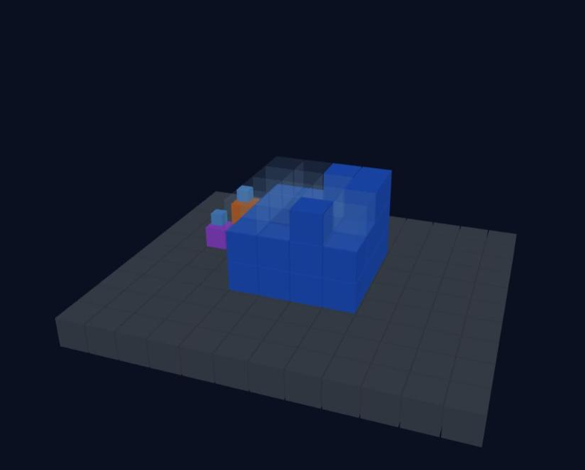
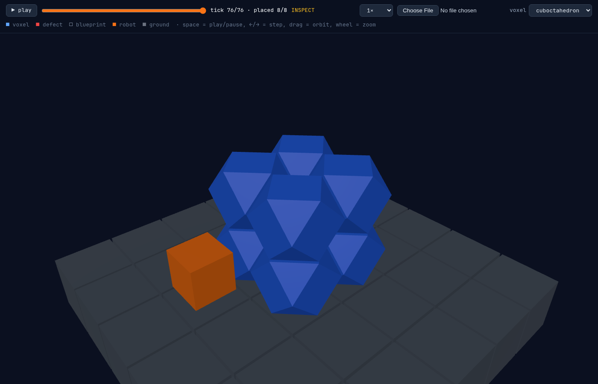
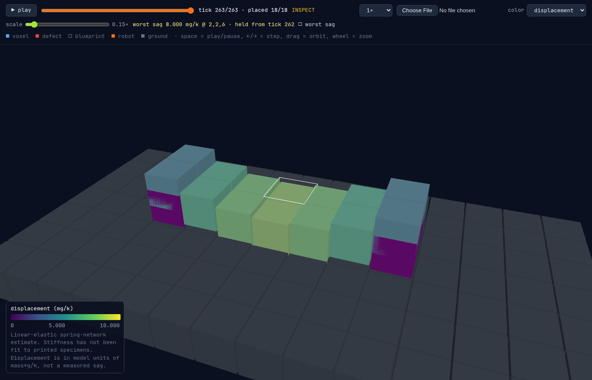
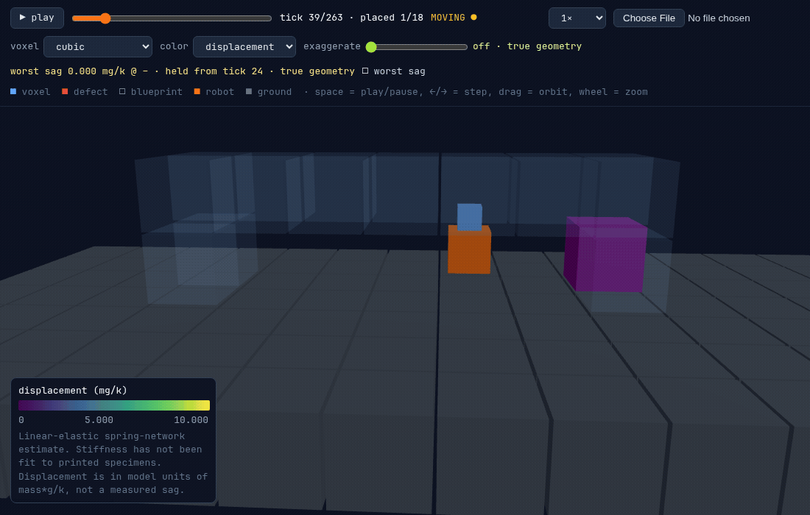
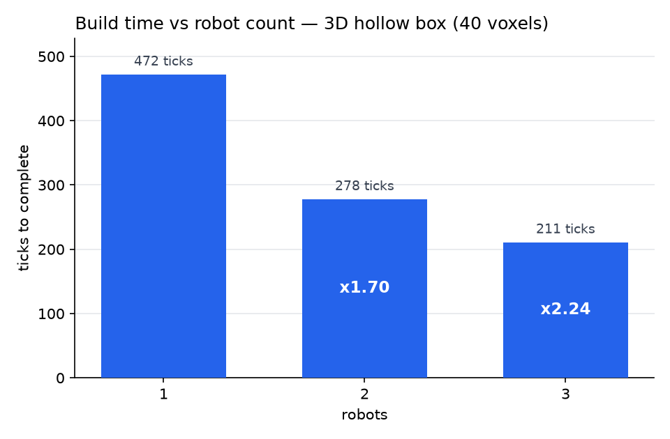
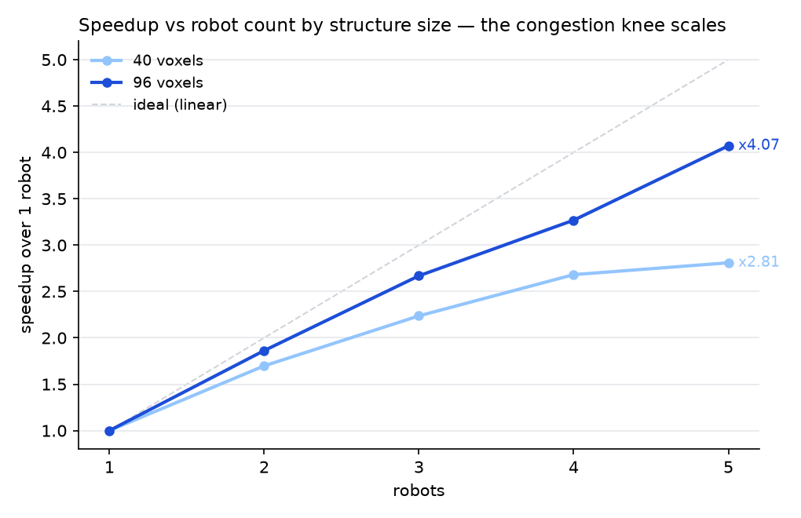
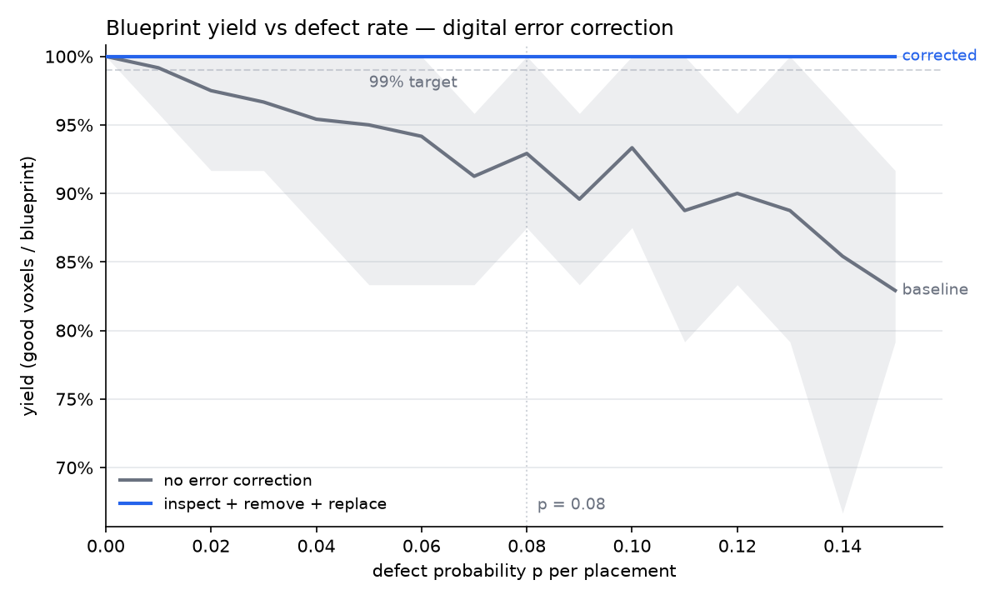
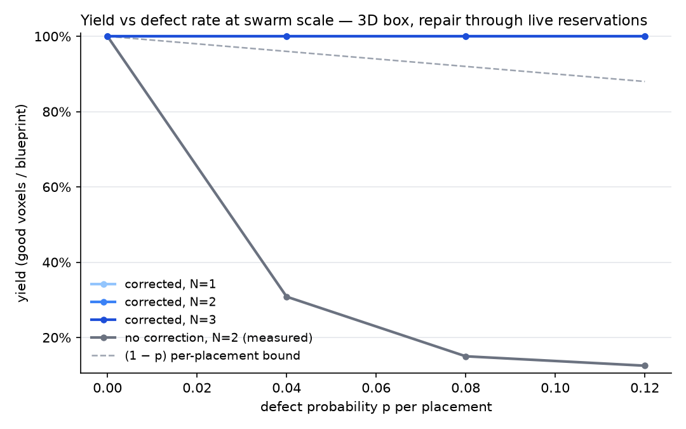
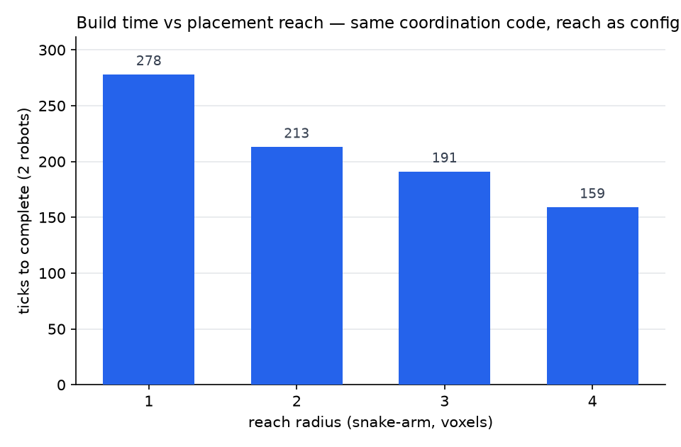

# discrete-assembly-sim

[](https://github.com/jdyar/discrete-assembly-sim/actions/workflows/tests.yml)
[](LICENSE)

[](CITATION.cff)

**An open coordination stack for lattice-building robot swarms: blueprint → validated build order → multi-robot choreography → verification & error correction — with a replayable log of every run.**

Small "relative robots" (MIT BILL-E / NASA ARMADAS lineage) crawl on the voxel structure they are building: they fetch parts from a depot, claim tasks from a solver-validated build order, negotiate space through a shared reservation table, inspect every placement, and remove-and-replace defective parts *while the rest of the swarm keeps working*.



**30-second version:** the robots for discrete lattice assembly exist (NASA, MIT, Harvard have all flown or published them) — but the *coordination software* is the missing layer. NASA's planner isn't public. While building this, the author looked through related public codebases and did not find a maintained end-to-end stack; that pass is **not** archived here, so the "42 codebases" figure in older notes is an author count, not a survey you can re-run from this repo. The strongest academic planner in that pass (pb-construction) had no license file — an observation about the repo at the time, not a legal opinion. This repo is that layer, MIT-licensed, built so you can plug in **your** robot's capabilities as config.

**📄 Read the whitepaper: [WHITEPAPER.md](WHITEPAPER.md)** — the full technical account: architecture, the trap-suite benchmark, all five experiments (including the negative results), provenance, and limitations. It's the citable version of this repository.

## Install & quickstart

Requires Python 3.10+. Pure Python + numpy + matplotlib — no game engine, no ROS, no build step.

**Use it as a library in your own project:**

```bash
pip install git+https://github.com/jdyar/discrete-assembly-sim.git
python -c "import sim; print(sim.__version__)"   # 0.1.0
```

**Or clone it to run the demos, experiments, and examples:**

```bash
git clone https://github.com/jdyar/discrete-assembly-sim.git && cd discrete-assembly-sim
python -m venv .venv
source .venv/bin/activate        # Windows: .venv\Scripts\activate
pip install -r requirements.txt

python examples/hex_lattice.py      # bring-your-own-LATTICE tutorial (see below)
python examples/my_robot.py         # bring-your-own-ROBOT tutorial
python examples/cuboct_lattice.py   # cuboctahedral voxels on the cubic grid

python main.py swarm3d 2      # 2 robots build a 3D hollow box -> runs/latest.json
python main.py bridge         # stability gate on, strain log -> runs/bridge.json
python main.py cuboct         # 2×2×2 cuboctahedra -> runs/cuboct.json
python main.py stability     # gate cost and effect -> docs/stability_cost.csv
python main.py speedup3d      # speedup-vs-N (1..5) experiment -> runs/speedup_3d.png
python main.py reach3d        # build ticks vs reach radius -> runs/ticks_vs_reach.png
python main.py yield3d        # swarm-scale yield vs p vs N -> runs/yield3d.png
python main.py knee3d         # congestion knee vs structure size -> runs/knee_vs_size.png
python main.py swarm 2        # 2 robots, 2D wall (the degenerate case, kept honest)
python main.py                # single robot, defects + repair (the yield demo)
python main.py yield          # the yield-vs-p experiment -> runs/yield_vs_p.png

python -m unittest            # 168 tests: traps, 3D repair, fuzz, examples, stability, strain log, cuboct
```

**Watch a run:** open `replay_viewer.html` in a browser and drop `runs/latest.json` onto it — play / pause / scrub / orbit, 2D and 3D logs both. Serve the repo root (`python -m http.server`) and it auto-loads the latest run. A log written with strain sampling (`python main.py bridge` → `runs/bridge.json`) adds a color mode for displacement or joint strain, a colorbar, a scale slider, and a marker on the worst-sag voxel. Logs without that data play exactly as before. On a 3D log the voxel menu switches cubic boxes and cuboctahedra. `python main.py cuboct` sets `meta.voxel_shape` so the viewer opens on cuboctahedra; a log that omits the key, including every older log, stays cubic. The menu is a drawing toggle. It does not change the cell graph, and it is not a measurement of ARMADAS hardware.





The figure is that bridge demo: the stability gate is on (`max_cantilever` 3), one robot, stiffness left at the unfitted default `k = 1`. Finished midspan sag is 8 in units of `mass·g/k`. The slider's 1× draws that model displacement in voxel lengths; above 1× exaggerates the shape, and the picture above is at 0.15× so the deck stays readable. Joint-strain mode colors each voxel by its largest incident face joint (axial, positive in tension, or shear). Stiffness has not been fit to a 3D-printed specimen. The same coloring over the build: 

## Why 3D is the game

The same coordination code that manages **zero speedup in 2D** (a wall build is a single-file corridor — the second robot starves) gets **real parallelism in 3D**, because the structure's surface gives robots room to route around each other:



Zero collisions, zero deadlocks, roof placed last so nobody gets sealed inside — and the chart shows the honest part too: the **congestion knee**. On this 40-voxel box the fifth robot buys only ×1.05 marginal speedup; contention for stances and the depot becomes the binding constraint. Reproduce with `python main.py speedup3d`.

The knee is a property of the *structure*, not the stack: give the same swarm a 96-voxel box and five robots reach **×4.07** with no knee in sight (`python main.py knee3d`):



## Error correction makes yield digital

Discrete ("digital") materials promise what error correction gave to data: **reliable wholes from unreliable steps**. Each placement fails with probability *p* (a bad bond). A blind builder's yield decays like (1−p)ⁿ; a builder that inspects, removes, and replans holds ~100% yield and pays time instead:



At p = 0.08 (10 seeds): **corrected yield 100%**; the baseline decays to ~83% at p = 0.15. Reproduce with `python main.py yield`. The same unpublished author pass did not find a working inspect-remove-replan loop; that is context, not a counted result.

At **swarm scale** the stakes turn out to be higher than the single-robot chart suggests. With multiple robots and safety gates, an uncorrected defect doesn't just subtract from yield — it **poisons the buildability proofs and jams the coordinated build** near the defect. Corrected swarms hold 100% at every robot count; uncorrected ones stall far below the (1−p) decay line:



Reproduce with `python main.py yield3d`. The repair experiment also caught a genuine concurrency bug — a repair replan racing another robot's still-standing defect — now fixed with a regression test pinning the exact interleaving (`tests/test_swarm3d.py`).

## Structural gate results

The stability gate is off unless you pass a `StabilityPolicy`. `python main.py stability` is the measurement of turning it on: 312 trials, gate off against `max_cantilever` 0, 1, 2, 3, and none. Stiffness is the default **k = 1**. Every sag number below is `estimate_sag` in model units of `mass·g/k`. It has not been fit to a printed specimen; that calibration is still waiting on specimen tests.

Named cells are 3 start seeds (0, 1, 2) × 1 and 2 robots, so n = 6. A search that hits the 200-node cap is undecided, not a rejection. A finished structure past the cantilever limit is a rejection from the precheck, and the order search does not run. This run has no undecided trials: 202 proved feasible, 110 proved infeasible. Points on the charts are trials; the bar is the median. The full spread, including idle robot-ticks and planning seconds, is in [WHITEPAPER.md](WHITEPAPER.md) §6.6 and `docs/stability_cost.csv`.


On the span-5 bridge the finished sag is 6. With the gate off, the peak during the build is 15 on four of the six trials and 10 on two. Limit 2 is the tightest setting that still accepts the deck, and all six trials then peak at 6. Limit 3 leaves a peak of 10. Limits 0 and 1 are proved infeasible, 6/6. The span-6 bridge repeats it one step looser: gate-off peak median 21 (range 15–21), limit 3 peaks at 10 on all six, finished sag 8, and limits 0–2 are proved infeasible. A pure cantilever keeps the peak it had with the gate off, once the limit allows the arm: length 3 stays at 10, length 4 stays at 15, and length 4 is rejected at every finite limit. Every gate-off length-4 trial logged 5 singular sag samples; with the connectivity rule on, that count is 0. The wall peaks at 3 in every trial. The hollow 3×3×2 roof is proved infeasible at limit 0, 6/6: the center cell has no column under it and its overhang lower bound is 1, so the precheck rejects it (median 0.096 ms, range 0.088–0.120 ms). Limits 1 and 2 allow that bound. At every limit that allows the roof, peak sag matches the gate-off runs.


The search that finds a legal order stays at about 0.03 s. The cost is the build. Span-5 at limit 2: one robot goes from 78–85 ticks and 0 kickbacks to 104–135 ticks and 3–6 kickbacks; two robots go from 50–56 ticks and 0 kickbacks to 69–112 ticks, 4–26 kickbacks, and 24–80 idle robot-ticks. Four fuzz shapes (a small wall, a span-6 bridge, a length-3 cantilever, a ledge; seeds 1001–1004, n = 4) repeat the same split. Reproduce with `python main.py stability`.

## Plug in your robot

The design bet of this repo: **coordination logic is invariant to robot hardware.** Everything your robot *is* lives behind two small seams, and the choreographer never looks past them.

**Don't take the claim on faith — run the tutorials.** [`examples/hex_lattice.py`](examples/hex_lattice.py) implements a hexagonal lattice (which exists *nowhere* in the core library) in ~80 lines and runs the unchanged planner, validator, and two-robot swarm on it. [`examples/my_robot.py`](examples/my_robot.py) builds one blueprint under four different hardware configurations and prints what each buys you. Both are wired into the test suite so they can't rot. The step-by-step walkthrough — including the `WorldLike` protocol your world object must satisfy — is in [`examples/README.md`](examples/README.md).

- **`Geometry`** (`sim/geometry.py`) — what a lattice is: `neighbors(node)`, `is_footing(node)`, `reach_cells(node)`. Nodes are opaque values; the 2D square lattice and the 3D cubic lattice are both ~150-line implementations, and the test suite includes a string-node triangle-lattice fake to prove nothing upstream assumes coordinates. `CuboctahedralLattice3D` (`sim/cuboct.py`) is the optional third: cuboctahedral voxels on the cubic grid, same six face-neighbors and the same robot rules, different vertices and square-face joint sites. The cubic lattice stays the default.
- **`MotionModel`** (`sim/geometry3d.py`) — what your robot can do, all config: **`reach_radius`** with snake-arm articulation (a target is reachable iff an empty-cell path of length ≤ radius runs from stance to target — bends around corners, never through walls); **`stride`** (multi-cell inchworm tick-moves, with swept cells protected by the reservation machinery via `move_footprint`); **`climb`** (0 = a ground-bound gantry robot, 1 = a TERMES-class climber); and **coupled pairs** (`MotionModel.coupled` — two attached robots as one logical robot with a combined arm chain, the BILL-E cooperative-manipulation lineage; dynamic mid-run attach/detach is future work).

If your lab's robot climbs exactly one block (TERMES-style), that's config. If it places four cells away around a corner, that's config — and here's what turning that one knob does, with zero coordination changes:



The sequencer, reservation table, connectivity gates, and repair loop don't change — that invariance is tested, not aspirational: the 3D pivot ran the entire coordination stack on a new lattice with zero logic changes, and the reach experiment (`python main.py reach3d`) re-runs the same build at radii 1–4 through the same planner.

The **trap fixtures** (`tests/test_traps.py`, `tests/test_traps3d.py`) double as a benchmark: each one encodes a published failure class — TERMES-style enclosure deadlocks, MAPF corridor swaps, single-path interiors — with the reasoning in its docstring. If you're building your own planner, point it at these.

## How it works

```
main.py                 # entry point / run configs (the modes above)
sim/
  world.py, world3d.py  # occupancy grids (2D / 3D) + blueprint masks
  geometry.py           # THE SEAM: lattice interface + 2D square lattice
  geometry3d.py         # 3D cubic lattice + MotionModel (reach as config)
  cuboct.py             # optional cuboctahedron on that same cubic grid
  planner.py            # build-order solver (proves safety at every step) + validator
  stability.py          # optional structural screen + linear-elastic sag (off unless asked)
  sequencer + swarm.py  # task claiming, kickback loop, displacement, watchdog
  choreographer.py      # cooperative A* over a time-expanded graph + placement gates
  reservations.py       # the shared table: leases (movement) + deeds (placement)
  texgraph.py           # time-expanded graph (space x time successor generation)
  robot.py              # single-robot state machine (the Slice 1-2 build)
  metrics.py            # replayable JSON run logs (v1/v2/v3) + charts
  render.py             # ASCII + matplotlib animation
tests/                  # 168 tests incl. spec-first adversarial trap fixtures
replay_viewer.html      # zero-build Three.js replay viewer (2D + 3D)
docs/DESIGN.md          # binding architecture rules + provenance per stage
```

The multi-robot core, in one paragraph: an idle robot claims the nearest task from the **sequencer**'s validated build order, and the **choreographer** plans its whole task (to depot → pick → to stance → place → inspect) as a shortest path through a **time-expanded graph** — space × time, where waiting is a move — against everyone's existing reservations. Before committing, two gates run: the placement must not disconnect any robot's future from the depot (**connectivity gate**, proven on the world-plus-all-deeds graph), and must leave the rest of the blueprint completable (**buildability gate**). An optional third gate, **structural stability**, stays off unless you pass a `StabilityPolicy`: every voxel must face-connect to a column on the base, and nothing may stick out past a cantilever limit. The same opt-in can record the spring-network sag after each placement (`StructureLog` on a `RunLog`): per-voxel displacement and a per-joint strain proxy, split into axial and shear. Sampling follows occupancy changes, every `every` changes (default 1), which is cheap out to about a hundred voxels. The viewer colors by those samples. The colors are the model estimate — stiffness has not been fit to 3D-printed specimens, and the default colorbar is in units of `mass·g/k` unless you pass `si=True` with SI inputs. A refusal from any gate is a **kickback**: the task returns for reordering and the world moves on — never a deadlock, never a frozen swarm. A defect found at inspect triggers remove + re-sequence *through* live traffic. Full rules and provenance: [docs/DESIGN.md](docs/DESIGN.md).

## Background & references

A software study of the **discrete lattice assembly** lineage — simulator, not flight hardware:

- **Digital materials** — Gershenfeld et al. (MIT CBA); Cheung & Gershenfeld, *Reversibly Assembled Cellular Composite Materials*, Science 341, 1219–1221 (2013), doi:10.1126/science.1240889. Their "cuboct" lattice is vertex-connected octahedra, not the face-joined cuboctahedron in `sim/cuboct.py`.
- **Relative robots** — Jenett & Cheung, *BILL-E: Robotic Platform for Locomotion and Manipulation of Lightweight Space Structures*, AIAA 2017-1876 (2017), doi:10.2514/6.2017-1876, NTRS 20170006219. BILL-E walks the octahedral lattice from the 2013 paper. Cooperative manipulation between coupled robots is the `MotionModel.coupled` config.
- **NASA Ames ARMADAS** — face-joined cuboctahedral voxels (six square faces, four fasteners per face), SOLL-E inchworm builders, autonomous meter-scale builds. Gregg et al., *Ultralight, strong, and self-reprogrammable mechanical metamaterials*, Science Robotics 9, eadi2746 (2024), doi:10.1126/scirobotics.adi2746 (17 January 2024; NTRS 20230005194). The year 2018 sometimes attached to that title is wrong. The choreography here is implemented clean-room from the published planning description: cooperative A*, node reservations, storage-location deadlock-freedom. The optional cuboct solid matches that voxel's face graph and joint locations. It is not a calibrated model of the hardware.
- **TERMES** — Werfel, Petersen & Nagpal (Science, 2014) + Petersen et al.'s error taxonomy; source of two of the trap-fixture failure classes.
- **MAPF** — Stern et al., *Multi-Agent Pathfinding: Definitions, Variants, and Benchmarks* (arXiv:1906.08291); source of the corridor-swap trap.
- **Theory backbone** — Winfree's Tile Assembly Model; the 1980 NASA self-replicating lunar factory study as the long arc.

## Roadmap

Built in vertical slices — every milestone is a running end-to-end program with a metrics chart:

- ✅ World, blueprint, single robot, validated build orders (6×4 wall)
- ✅ Error correction: inspect / remove / replan, ≥99% yield at p = 0.08
- ✅ Multi-robot choreographer: reservations, gates, adversarial trap suite (2D)
- ✅ 3D: cubic lattice behind the same interface, first real speedup
- ✅ 3D at scale: fuzzed coupled loop (40-case campaign clean), mid-swarm repair in 3D, speedup-vs-N to 5 with the congestion knee identified (N≈4 on the 40-voxel box)
- ✅ Snake-arm reach as config (radii 1–4 through the unchanged planner; ×1.75 at reach 4)
- ✅ Motion-model remainder: multi-cell stride (reservation-sound swept cells), climb limit, coupled-robot pairs
- ✅ Yield-vs-p at N in 3D (corrected 100% everywhere; uncorrected swarms jam, not decay); congestion knee vs structure size (×4.07 at N=5 on 96 voxels)
- ✅ Structural checks, off by default: grounded connectivity, a cantilever limit, and a linear-elastic sag estimate. Milestone 3 (`python main.py stability`) measures the gate: on a span-5 bridge, limit 2 cuts peak intermediate sag from a median of 15 (range 10–15) to 6, and pays in makespan and kickbacks. Stiffness is still uncalibrated (k = 1). Still open: load cases beyond self-weight, a displacement limit inside the gate, fastener-level cuboct stiffness
- ✅ Cuboctahedral voxels, milestone 4 (optional, cubic stays the default): same 6-neighbor grid and the same lumped face springs, so the sag closed forms still hold; different vertices and square-face joint sites; viewer menu draws either solid. Geometry and joint locations only — not a validated mechanical model of ARMADAS hardware (`python main.py cuboct`)
- ✅ Strain visualization, milestone 2 (optional, off by default): per-placement displacement and joint-strain samples in the run log, and a viewer that colors, exaggerates, and marks the worst-sag cell. The picture is the uncalibrated spring model, not a measurement on a printed part
- ⏳ Dynamic robot coupling (mid-run rendezvous/attach/detach)
- ⏳ Typed part families
- ⏳ Hierarchical sequencing for 10³+-voxel blueprints

## Contributing & feedback

Contributions and criticism are both welcome — this is meant to be the reference implementation the field can legally build on, and it gets better with more eyes on it.

- **Easiest high-value contribution: break it.** Write a trap — a blueprint + robot placement you believe deadlocks, starves, or entombs a robot — as a test like the ones in `tests/test_traps3d.py`. If it fails, you've found a real bug and the fixture is the regression test.
- **Have different hardware?** Implement a `Geometry`/`MotionModel` for your lattice or robot and tell us what the interface couldn't express — interface gaps are the most valuable bug reports this project can get.
- **Know this literature?** If we've mis-read or missed prior art (especially on reservation schemes or repair-during-construction), open an issue with the citation. Provenance corrections are taken seriously — see the clean-room policy in [docs/DESIGN.md](docs/DESIGN.md).
- Start with [CONTRIBUTING.md](CONTRIBUTING.md) for setup, test conventions, and the list of good first issues. For questions and design discussion, use [GitHub Discussions](../../discussions); for bugs, [Issues](../../issues).

## Citing

If you use this stack or benchmark against its trap suite, cite via [`CITATION.cff`](CITATION.cff) (GitHub's "Cite this repository" button uses it). The preferred citation is the [whitepaper](WHITEPAPER.md).

## License

MIT — see [LICENSE](LICENSE). Released permissively on purpose: the academic code in this space is almost entirely unlicensed or noncommercial, and the field needs a reference implementation it can legally build on.
