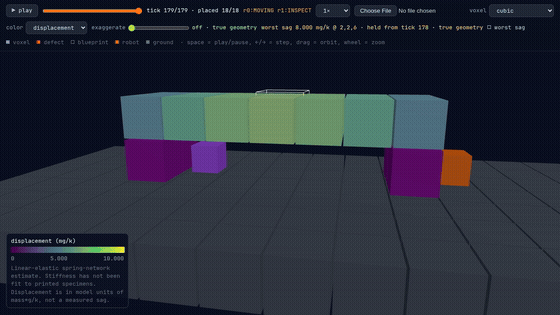

# discrete-assembly-sim

[](https://github.com/jdyar/discrete-assembly-sim/actions/workflows/tests.yml)
[](LICENSE)

[](CITATION.cff)

**An open coordination stack for robots that build a lattice by walking on it, plus an optional structural layer that says whether the partial build can stand.**

A blueprint becomes a validated build order. Relative robots (the BILL-E / ARMADAS lineage) fetch parts, claim tasks, and share space through a reservation table. A bad bond is removed and replaced while the rest of the swarm keeps working. v0.2, still untagged, adds a stability gate, a linear-elastic sag model with closed forms, a replay that colors that model, a 312-trial measurement of what the gate costs, and an optional cuboctahedral solid on the same cubic grid. Stiffness has not been fit to a printed part. The installed package version remains 0.1.0 until that fit exists and v0.2.0 is tagged ([CHANGELOG.md](CHANGELOG.md)).

## 30-second quickstart

Python 3.10+. NumPy and Matplotlib. No ROS, no game engine.

```bash
git clone https://github.com/jdyar/discrete-assembly-sim.git && cd discrete-assembly-sim
python -m venv .venv && source .venv/bin/activate
pip install -r requirements.txt

python -m unittest                 # 168 tests
python main.py bridge              # 1 robot, gate on, strain log -> runs/bridge.json
python main.py cuboct              # 2×2×2 cuboctahedra -> runs/cuboct.json
python main.py stability          # 312-trial gate campaign -> docs/stability_cost.csv
```

Open `replay_viewer.html` and drop `runs/bridge.json` on it (or serve the repo root with `python -m http.server` and it loads `runs/latest.json`). Displacement color, a scale slider, and a marker on the worst-sag cell appear only when the log has samples. `pip install git+https://github.com/jdyar/discrete-assembly-sim.git` then `import sim` prints **0.1.0** until the tag.

A ~60 s headless capture of a **two-robot** bridge (strain color, exaggerated display scale) and a cuboct block is `python scripts/render_demo.py`. That script needs Playwright, ffmpeg, and Chrome; it is not part of `requirements.txt`. The mp4 is written under the artifacts directory, not committed.

## Strain-colored bridge


The still of the finished deck, same run, worst-sag cell in a white cage: 

A five-second excerpt of the two-robot recording (`scripts/render_demo.py`) is below. The display scale there is 0.50× and the camera is a side view, so the midspan droop is the point of the picture. Same unfitted `k = 1`. The minute-long cut, with title cards and the cuboct block, is an artifact of that script and is not committed.



That run is `python main.py bridge`: one robot, `max_cantilever` 3, `k = mass = g = 1`. Finished midspan sag is 8 in units of `mass·g/k`. The slider's 1× draws the model displacement in voxel lengths. Above 1× exaggerates further. At the default stiffness, 1× is already several voxel-lengths, which is why the pictures are at 0.15×. Joint-strain mode colors each voxel by its largest incident face joint (axial, tension positive, or shear). Nothing in the picture has been fit to a printed specimen.

## What v0.2 adds

The gate and the sag solver stay out of the planner unless a caller passes a `StabilityPolicy`. Sections of the [whitepaper](WHITEPAPER.md) that predate the gate (§6.1–§6.5) were run with it off.

- **Stability gate** (`sim/stability.py`). Every voxel must face-connect to a column on the base. Horizontal overhang is capped by `max_cantilever`. A hanging block inherits the beam's overhang: fasteners are assumed to take tension, not masonry. A refusal uses the existing kickback. Another robot's unplaced deed is not a support.
- **Sag model and closed forms.** Voxels are nodes, one lumped axial/shear spring per face, `Ku = mg`. A one-voxel-wide cantilever of `n` free bays has tip sag `(mg / k_shear) · n(n+1)/2`. A tower shortens by the same expression with `k_axial`. Tests check the solver against those formulas.
- **Strain viewer.** Opt-in `StructureLog` samples displacement and a joint-strain proxy (relative displacement over pitch) onto the run log. The viewer colors, exaggerates, and marks `worst_sag_cell`. Older logs still play.
- **Gate campaign.** `python main.py stability`, 312 trials, raw rows in [`docs/stability_cost.csv`](docs/stability_cost.csv). Summary in the next section. `k = 1`.
- **Cuboctahedral voxels** (`sim/cuboct.py`, `python main.py cuboct`). Optional. Same six face-neighbors and the same lumped springs, so the closed forms still hold. Twelve vertices at the edge midpoints of the bounding cube, and four joint sites at the corners of the shared square. The cubic solid stays the default. Geometry only: not a calibrated model of the ARMADAS voxel ([Gregg et al. 2024](https://doi.org/10.1126/scirobotics.adi2746)).
- **Stability precheck.** Before the order search, overhang in the *finished* structure lower-bounds every prefix. A blueprint that already fails the cantilever limit is rejected without spending the node budget. The screen does not reject a blueprint the search could return.

168 tests cover the traps, the 3D repair loop, fuzz, the examples, the screen, the precheck, the strain log, a smoke run of the campaign, and the cuboct solid.

## Results

Numbers below are `estimate_sag` at `k = mass = g = 1`, in model units of `mass·g/k`. They are not millimeters. Named cells are start seeds {0, 1, 2} × 1 and 2 robots, so **n = 6**. Spreads are min–max. A search that hits the 200-node cap would be undecided; this run has none. Source: `docs/stability_cost.csv` and `docs/stability_cost_summary.txt` (Python 3.12.3). Charts: `docs/stability_peak_sag.png`, `docs/stability_makespan.png`.

**Span-5 bridge** (8 voxels). Finished sag is 6. Limit 2 is the tightest setting that still accepts the deck.

| gate | peak sag (n=6) | N=1 makespan | N=2 makespan |
| --- | --- | --- | --- |
| off | median 15 (10–15); 0 kickbacks | median 80 (78–85), 0 kickbacks | median 54 (50–56), 0 kickbacks, idle 0–7 |
| limit 2 | 6 on all six trials (the finished sag) | median 118 (104–135), kickbacks 3–6, idle 0–6 | median 83 (69–112), kickbacks 4–26, idle 24–80 |

The sag drops. The build gets longer, and two robots pick up kickbacks and idle time. A search that finds a legal order on this cell stays at median 0.030 s (range 0.029–0.032 s, n=6). Limits 0 and 1 are proved infeasible, 6/6.

**Span-6 bridge** (9 voxels). Finished sag 8. Gate off, peak sag median 21 (range 15–21) at both N=1 and N=2. Limit 3, the tightest feasible setting, peaks at 10 on all six trials. N=1 makespan moves from median 95 (95–104) and 0 kickbacks to median 133 (125–133) and 3 kickbacks. N=2 moves from median 59 (58–68) and 0 kickbacks to median 87 (87–117), kickbacks 4–30, idle robot-ticks 32–90. Limits 0–2 are proved infeasible. Those rejections return from the precheck in well under a millisecond (span-6 medians 0.060 ms, 0.058 ms, 0.057 ms).

**Where the gate does not buy sag.** A pure cantilever keeps the peak it had with the gate off, once the limit allows the arm: length 3 stays at 10, length 4 stays at 15. Length 4 is proved infeasible at every finite limit, 6/6. What the connectivity rule removes there is singular intermediates: every gate-off length-4 trial logged 5 sag errors, and with the rule on that count is 0. The wall peaks at 3 in every trial. The hollow 3×3×2 roof is proved infeasible at limit 0, 6/6, median 0.0965 ms (range 0.088–0.120 ms), because the roof center has no column and its overhang lower bound is 1. The campaign before that precheck left the same six searches undecided at the 200-node cap (median 7.12 s, range 7.09–7.15 s); that figure is the earlier run recorded in [NOTES.md](NOTES.md), not a row in the current CSV. At every limit that allows the roof, peak sag matches the gate-off runs (median 1.542, range 1.441–1.909; finished sag 1.4).

Whole campaign: **312 trials, 202 proved feasible, 110 proved infeasible, 0 undecided.** Four fuzz shapes (seeds 1001–1004, n=4) repeat the same split. Reproduce with `python main.py stability`. The long form is [WHITEPAPER.md](WHITEPAPER.md) §6.6.

Coordination results from before the gate, regenerated with the gate off, are in the whitepaper §6.1–§6.5 and the charts under `docs/`: a 2D wall gives no speedup (406 ticks at one robot and at two); a 40-voxel hollow box goes from 472 ticks at one robot to ×2.81 at five, and a 96-voxel box reaches ×4.07 at five; corrected yield holds 100% at the tested defect rates, and uncorrected swarms jam (about 15% at p=0.08 in the 3D swarm chart) instead of following (1−p).

## Limitations and open validation

- **Stiffness is unfitted.** Every sag number in the campaign and in the pictures is `k = 1`. The colorbar is `mg/k` unless a run is built with `si=True` and SI inputs. There is no displacement limit inside the gate, because that limit needs a fit.
- **The load is uniform self-weight.** No robot weight, wind, payload, or fastener preload. A defective voxel keeps full stiffness until it is removed. Horizontal displacement under self-weight is identically zero.
- **The element is a spring, not a beam.** A one-piece part whose struts bend will not follow `n(n+1)/2`. For free lengths n=6 against n=3 the shear chain predicts tip-sag ratio **3.5**; Euler–Bernoulli self-weight scales as `n⁴`, ratio **16**. That comparison is the experiment in [docs/VALIDATION.md](docs/VALIDATION.md). The specimens are specified (one-piece PLA, 20 mm frames, 3 mm struts, clamp block, tip tab, Bambu P2S, 0.2 mm layers, 3 walls, hanger loads 0–100 g). **The results table is empty.** Do not read this repository as a calibrated material model.
- **Cuboct geometry is not cuboct mechanics.** Four fastener sites are drawn and reported. The solver still places one spring at the face center. Published ARMADAS density, strength, and modulus are not inputs. The 2013 "cuboct" lattice of vertex-connected octahedra ([Cheung & Gershenfeld](https://doi.org/10.1126/science.1240889)) is a different solid, and it is not implemented here. BILL-E walks that octahedral lattice ([Jenett & Cheung, AIAA 2017-1876](https://doi.org/10.2514/6.2017-1876)).
- **The gate is a screen, not a proof of strength.** `max_cantilever = 0` rejects any span, including a hollow-box roof, which is why it is off by default. Feasibility of robot motion is a separate question: a blueprint the precheck accepts can still be unreachable.
- **Still open in the coordination stack:** dynamic attach and detach, typed part families, hierarchical sequencing past about 10³ voxels, more than one depot. The author's mid-2026 pass over public codebases is not archived in this repo; counts from that pass are notes in the whitepaper, not a survey you can re-run.

## Layout

```
main.py                 # demos and experiments (bridge, cuboct, stability, ...)
sim/stability.py        # gate, sag solver, closed forms, precheck
sim/cuboct.py           # optional cuboctahedron on the cubic grid
sim/planner.py          # build-order search; calls the precheck when asked
replay_viewer.html      # drop a log; colors strain when the log has it
scripts/render_demo.py  # ~60 s Playwright + ffmpeg capture
docs/VALIDATION.md      # print plan and empty results log
docs/stability_cost.csv # 312-trial gate campaign
WHITEPAPER.md           # citable technical account
CHANGELOG.md            # v0.2.0 unreleased
```

Background for the coordination stack, the trap suite, and the motion model: [WHITEPAPER.md](WHITEPAPER.md) and [docs/DESIGN.md](docs/DESIGN.md). Worked seams for a lattice or a robot that is not in the core: [examples/README.md](examples/README.md). Contributing: [CONTRIBUTING.md](CONTRIBUTING.md).

## Citing

Cite via [`CITATION.cff`](CITATION.cff). The preferred citation is the [whitepaper](WHITEPAPER.md). The citation record is still the 0.1.0 release; the structural additions are untagged.

## License

MIT. See [LICENSE](LICENSE).
