# An Open Coordination Stack for Discrete Lattice Assembly: Motion-Invariant Multi-Robot Choreography with In-Situ Error Correction

**Joshua Dyar** · July 2026, revised October 2026 (v0.2 structural model, untagged) · [github.com/jdyar/discrete-assembly-sim](https://github.com/jdyar/discrete-assembly-sim) · MIT License

---

## Abstract

Robots that assemble large structures from discrete lattice blocks exist: NASA's ARMADAS has demonstrated autonomous meter-scale builds, and the BILL-E and TERMES lineages established the underlying locomotion and construction models. The *coordination software* — the layer that turns a blueprint into a validated build order, choreographs multiple robots through shared space, and repairs defective placements mid-build — has no open, reusable implementation. We present one. The stack contributes: (1) a coordination core (cooperative A\* over a time-expanded graph, a lease/deed reservation table, and two placement gates that provably prevent robot entrapment and unbuildable states, plus an optional third gate — structural stability, off by default, so §6.1–§6.5 are unchanged) that is **invariant to lattice geometry and robot motion capability**, both of which are injected as configuration; (2) an in-situ error-correction loop that detects, removes, and replaces defective placements *through live reservations*, without halting the swarm; (3) an adversarial trap-fixture suite, grounded in published failure classes, usable as a benchmark by other planners; and (4) a replayable run-log format with viewer and chart tooling. We report supporting experiments: a measured negative result for 2D multi-robot assembly (zero speedup; single-file corridor topology); 3D speedup of ×2.81 (5 robots, 40-voxel structure) rising to ×4.07 on a 96-voxel structure, locating the congestion knee as a property of structure size rather than of the stack; placement reach as pure configuration (×1.75 build-time improvement from reach 1→4 with zero coordination changes); and swarm-scale yield experiments showing corrected yield of 100% across all tested defect rates and robot counts, while *uncorrected* swarms jam far below the classical (1−p) decay — standing defects poison build-order feasibility proofs, making error correction a liveness requirement at swarm scale, not merely a yield optimization. Separately, §6.6 turns the structural gate on: on a span-5 bridge the tightest limit that still accepts the deck cuts peak intermediate sag from a median of 15 (range 10–15, n=6) to 6, equal to the finished span, and longer cantilevers are proved infeasible. The price is makespan and kickbacks; a search that finds a legal order stays about 0.03 s. Stiffness in that measurement is uncalibrated (k = 1 model units). The model, its assumptions, and the closed forms are §3.4. An optional cuboctahedral solid (§3.3) uses the same cubic cell grid and the same lumped face springs; it changes vertex and joint locations only, and it is not a mechanical model of ARMADAS hardware. The default solid remains the cube. The print that would calibrate `k_shear` — one-piece PLA cantilevers of 3 and 6 free bays, self-weight tip ratio 3.5 on the shear chain against 16 for Euler–Bernoulli self-weight — is specified in `docs/VALIDATION.md`. That table has no measurements. v0.2.0 is untagged until it does, and the package version remains 0.1.0. §6.7 turns on an optional second locomotion: both feet grip voxel faces, and the robot's weight is a point load at those voxels. On a two-pier bridge the inchworm's only route is a one-sided deck, and both the cantilever gate and a sag cap set to the finished loaded structure reject that order, 3/3. The default crane stance can walk the ground; under the cantilever gate its place order puts the far cap down before the last span cell, and the peak falls from 6 to 3. Mass ratios 1, 3, and 10 are a sweep. The only published robot-to-voxel masses this paper quotes are SOLL-E's, about 12.6 (cargo) and 11.6 (crane), and they are not rows in the file. Stiffness is still the unfitted `k = 1`. §3.5 gives each face joint a strength beside its stiffness. The load is the spring force from the same solve. A joint-utilization gate, off unless a `JointCap` is passed, rejects an order whose demand exceeds capacity times a safety factor. §6.10 measures which builds are shear-limited, which are compression-limited, and that a cap at the finished demand does not increase the scaffold count. The published 3×3×3 compression figures are checked there. The per-face newton number is derived and is not applied to a `k = 1` solve. §3.6 draws a position and an angle on each new voxel and tests them against the ski and claw envelopes in that same paper. A capture snaps to the elastic average of the mating faces. A miss is the existing defect flag. §6.11 is the Monte Carlo on cantilevers, bridges, and the shelter: with the snap on, position RMS stays at numerical zero and the miss rate follows the closed form (0.247 on a single-mate chain, 0.432 on the shelter); without the snap, tip error grows with length and a long bridge stops short of the far pier. Stiffness is not an input to that draw. Sag elsewhere remains the unfitted `k = 1`. All results regenerate from a pure-Python repository with a 254-test suite. §6.9 is a throughput model of the 256-voxel ARMADAS shelter: role-specialized robots, one fasten task per joint, and a feed station. The baseline is 42.972 h against the manuscript's approximately 100.4 h. It was not fitted.

---

## 1. The software gap

Discrete ("digital") lattice assembly builds large structures from small families of reversibly joined blocks. The approach descends from digital materials [Cheung & Gershenfeld 2013] and is embodied in hardware today: relative robots that walk on the lattice they build — MIT's BILL-E [Jenett et al.], Harvard's TERMES [Werfel, Petersen & Nagpal 2014], and most completely NASA Ames' ARMADAS, whose SOLL-E robots autonomously assembled a meters-scale shelter from cuboctahedral voxels [Gregg et al., *Science Robotics* 2024]. The hardware thesis is proven.

The software that coordinates such robots is where the field is thin. In mid-2026 the author looked through public research codebases across the MIT CBA, NASA-adjacent, TERMES, and assembly-planning literatures. Working notes from that pass said 44 repositories, 42 of them read closely. **That list is not in this repository, and it has not been re-audited.** The counts below are author notes, not a survey a reader can re-run. Three impressions from that pass motivated the work; they should be read with that limit:

1. **No open end-to-end toolchain found in that pass.** Nothing the author found that was public and maintained covers blueprint → validated build sequence → multi-robot choreography → verification/error-correction. Fragments exist; the pipeline, in that reading, did not.
2. **The strongest academic planner found was not reusable as published.** The most complete multi-robot construction-planning codebase in the pass (pb-construction, RSS 2020 lineage) had **no license file**. Absence of a license file is not a legal ruling — it means this repository could not verify a grant of rights, so this project does not build on that code. Check the upstream repository's current license before repeating this as a legal conclusion.
3. **A working mid-build repair loop was not found in that pass.** In the codebases the author read, error correction during construction appeared as closed-form theory or as shipped-disabled fragments. None of them, in that reading, detects, removes, and replaces a defective placement while other robots keep working.

Consequently every lab with new lattice-robot hardware re-solves coordination privately. This paper and its repository are an attempt to make that unnecessary: an MIT-licensed reference implementation whose coordination core is deliberately *independent of the robot* — labs plug in their own lattice and kinematics as configuration.

**Contributions.** C1: a motion- and lattice-invariant coordination stack (§3–§4). C2: placement gating that makes entrapment and unbuildable states unreachable, coupled to sequencing by kickback (§4). C3: repair through live reservations at swarm scale (§4, §6.4). C4: an adversarial trap suite as a reusable benchmark (§5). C5: an open interchange format and tooling (§7). We claim engineering synthesis and openness, not algorithmic novelty: the planning core follows ARMADAS's published method (clean-room; §8), and our reservation vocabulary is an implementation note within that framework.

## 2. Problem setting

**World.** A bounded cubic voxel grid. Nodes are `(level, row, col)`; level 0 is a solid ground plane. Each cell is empty, ground, a placed voxel, or a *defective* voxel. A blueprint marks the cells that must hold good voxels. (A 2D square-lattice world with identical interfaces serves as regression base and as the setting for the negative result of §6.1.) An optional cuboctahedral solid (§3.3) occupies those same cells. The default solid remains the cube.

**Robots.** Surface-locomoting relative robots: a robot occupies one empty cell adjacent to structure, moves one *tick-move* at a time along the surface (orthogonal steps plus corner rounding, generalized per axis-plane from the machine-verified 2D rule set), carries one block, picks at a depot cell, and places into reachable cells. Robots sense only adjacent cells plus their task; global knowledge is limited to the blueprint and depot location. Motion capability beyond this baseline — reach radius, stride, climb, coupled pairs — is configuration (§3.2).

**Defect model.** Following ARMADAS's vision-free error detection (fastening-time feedback rather than machine vision), each placement is defective with probability *p*: the block occupies its cell and is crawlable, but does not count toward completion and is detectable only by a one-tick INSPECT from an adjacent stance. Repair = remove (one tick), discard, and re-sequence.

**Required properties.** Throughout every run: (S1) no two robots co-located; (S2) no robot ever entrapped — a path to the depot exists on the current world for every robot at every tick; (S3) the remaining blueprint stays completable; (L1) under defects, the swarm makes progress during repair (no global freeze). These are asserted per-tick by every test in the suite, including fuzz.

## 3. Architecture: coordination invariant to lattice and motion

The design bet of the stack is that **coordination logic should never know what lattice it runs on or what the robot's body can do.** Two seams enforce this.

### 3.1 The Geometry seam

A `Geometry` implementation answers five questions: `neighbors(node)` (legal tick-moves), `is_footing(node)` (may a robot occupy this node), `reach_cells(node)` (cells placeable/removable from this stance), `move_footprint(a, b)` (cells swept by a multi-cell move, §3.2), and `future_view(solids)` (the lattice as if given cells were already built — the substrate for the gates of §4.2). Nodes are opaque hashable values. The sequencer, choreographer, reservation table, and time-expanded graph perform no coordinate arithmetic; the test suite includes a string-node triangle-lattice fake to keep them honest.

The invariance claim is tested, not asserted: the stack was developed against a 2D square lattice, and the 3D cubic lattice was added **without changing a line of coordination logic**. (Two latent *defaults* — call sites that fell back to the 2D geometry factory — were exposed immediately by the spec-first 3D fixtures and fixed by giving Geometry a `bound_factory()`; we report this because it is the honest shape of such claims: the architecture held, the defaults did not, and the fixtures caught them.)

### 3.2 The MotionModel seam

Real lattice robots are not one-cell steppers. SOLL-E takes multi-voxel inchworm strides; BILL-E-class arms place blocks several cells away, articulate around corners, and can couple into longer chains [Jenett and Cheung, AIAA 2017-1876, NTRS 20170006219; US 10,046,820]. `MotionModel` expresses these as data:

- **`reach_radius`** with **snake-arm articulation**: a target is reachable from a stance iff a path of Chebyshev steps of length ≤ radius connects them whose *intermediate* cells are all empty — the arm bends around corners and over ledges, never through solid volume. Endpoints are exempt (the stance is the robot's own cell; a solid target is how inspect/remove address a placed block), which keeps the relation symmetric — the property the planner's stance inversion requires — at every radius. Radius 1 reduces exactly to the 26-cell shell.
- **`stride`**: a tick-move chains up to `stride` surface steps. Soundness is the interesting part: a stride move *sweeps through* cells it does not end on. `move_footprint` reports the swept cells; the time-expanded graph refuses moves whose footprint is not free across the whole transition window (both ticks — conservative, so a robot merely *departing* a swept cell still conflicts); the choreographer leases footprints along with each leg. This was the single interface extension that motion realism forced on the coordination layer — and it is the correct one to force: the coordination stack learns only that "a move may occupy more than its endpoints," never *why*.
- **`climb`**: maximum |level change| per tick-move. 0 yields a ground-bound gantry robot; 1 the TERMES-class climber; larger values pair with stride.
- **Coupled robots**: `MotionModel.coupled(other)` models two rigidly attached robots as *one* logical robot whose arm chain spans both — reach is the sum of radii; stride and climb take the pair's minimum. Coupling is thus a swarm-setup choice (spawn N pairs instead of 2N solos) requiring zero coordination changes. Dynamic mid-run rendezvous, attachment, and detachment require a pairing protocol in the task layer and are explicitly future work (§9).

A\*'s admissible heuristic scales with stride (⌈Chebyshev/stride⌉), and everything above is exercised at swarm scale in the test suite: stride-2 pairs threading live traffic, a coupled pair completing a build, crossing-safety through swept cells.

### 3.3 Cuboctahedral voxels (optional)

`CuboctahedralLattice3D` (`sim/cuboct.py`) is a second 3D geometry behind the same interface. It is off unless a caller passes it as `geometry_factory`. `python main.py swarm3d` still builds cubes.

The solid follows the ARMADAS voxel in Gregg et al., "Ultralight, strong, and self-reprogrammable mechanical metamaterials," *Science Robotics* 9, eadi2746 (2024), doi:10.1126/scirobotics.adi2746, published 17 January 2024 (NTRS 20230005194). A date of 2018 sometimes attached to that title is wrong. Each published voxel is six square faces, corner-to-corner 304.8 mm, so the bounding cube is 304.8 mm on a side, and voxels connect face to face with four fasteners at the corners of the shared square. In this model the center-to-center pitch is one cell. The twelve vertices are the permutations of (±1/2, ±1/2, 0) about the center: the midpoints of the bounding cube's edges. The four joint sites lie in the shared midplane, one half-pitch from the face center along a single transverse axis. A cube's four joint sites are the corners of the full face, a half-pitch out on both transverse axes, and those points are not vertices of the cuboctahedron. The face center itself, the midpoint between the two voxel centers, is the same point either way.

What stays the same is the cell graph. Nodes are still `(level, row, col)`. Face neighbors are still the six axis-adjacent cells. Footing, orthogonal steps, corner rounding, snake-arm reach, stride, and climb are the cubic rules: the class subclasses `CubicLattice3D` and replaces only the methods that would have rebuilt a cube (`bound_factory`, `future_view`). `stability_policy` is the cubic frame, +level up and level 0 the plate. `is_stable` walks that face graph. `estimate_sag` places one lumped spring on each shared face, axial stiffness along the center line and shear stiffness in the face plane, anchored at the face center. A one-voxel-wide bar is therefore still the path chain, and the closed forms of §9 still hold. The four fastener sites are locations. They are not four springs, and this model gives a single face no moment stiffness of its own.

Two earlier papers are the reason the name is easy to get wrong, and this geometry is not either of them. Cheung and Gershenfeld, "Reversibly Assembled Cellular Composite Materials," *Science* 341, 1219–1221 (2013), doi:10.1126/science.1240889, define a "cuboct" lattice of vertex-connected octahedra, coordination number 8, assembled from planar cross-shaped parts. Jenett and Cheung, "BILL-E: Robotic Platform for Locomotion and Manipulation of Lightweight Space Structures," AIAA 2017-1876 (2017), doi:10.2514/6.2017-1876 (NTRS 20170006219), put BILL-E on that octahedral lattice (pitch 76.2 mm, strut length P√2/2). This repository's surface rules are not a re-derivation of that gait.

`examples/cuboct_lattice.py` and `python main.py cuboct` build a 2×2×2 block with one robot on this geometry. The run log stays version 3. `meta.voxel_shape` is `"cuboctahedral"` for that run and is omitted from cubic runs, so older logs still draw boxes. The viewer menu can show either solid. Nothing in the number is a measured ARMADAS stiffness: there is no face-plate bending, no genderless-fastener compliance, and no use of the published density, strength, or modulus.

### 3.4 Sag model: assumptions and closed forms

`estimate_sag` (`sim/stability.py`) is a measurement of the partial build, not a gate and not a step inside the order search. The tests in `tests/test_stability.py` check the solver against the closed forms below. The assumptions:

- Voxels are nodes. Each face-adjacent pair is one linear spring: `k_axial` along the joint, `k_shear` on each perpendicular axis. Passing only `k` sets both. There is no rotational degree of freedom. A moment exists only as a couple between separate springs.
- Equilibrium is small-displacement, `Ku = f`, about the as-built geometry. Rest length does not appear: the spring wants zero additional relative displacement. Geometric stiffness, buckling, contact, and friction are absent. The factorization is dense NumPy, sized for a partial build you would print.
- A planted voxel — the cell directly beneath it is base — has every degree of freedom fixed. That is a rigid plate, not a compliant foundation. The stock infinite ground plane plants the whole first course. The cantilever formula needs a finite `base` under the root only.
- Every free voxel gets the same downward load `mass * g`. A defective voxel, if it is passed in, keeps full stiffness. The coordination stack's defect flag is not a crack. An optional `point_loads` sequence adds downward forces at voxel centers on top of that self-weight. Omit it and the solve is the historical uniform load.
- The three displacement axes decouple. Gravity is vertical, so the solved horizontal displacement under these loads is identically zero. There is no Poisson effect.
- Wind and fastener preload are not load cases. Robot weight is not a load unless a caller passes `point_loads`, or asks `robot_stance_ok` with a non-zero `robot_mass`. The default planner does neither.

A one-voxel-wide bar of `n` free voxels in a straight line, rooted on one fixed voxel, is a path of identical springs. Number the free voxels `i = 1` (nearest the root) through `i = n` (the tip). With weight `w = mass * g` and joint stiffness `k` in the loaded direction, each spring carries the weight of every voxel outboard of it:

```
u(i) = (w / k) * i * (2n − i + 1) / 2
u(n) = (w / k) * n * (n + 1) / 2
```

Horizontal bar, vertical load: `k` is `k_shear` (`shear_cantilever_tip_sag`). Vertical bar: `k` is `k_axial` (`axial_tower_compression`). `path_chain_deflection_at` is the profile. A point load `P` at the tip is carried by every spring, so it adds `P · i / k` at free voxel `i` and `P · n / k` at the tip (`point_load_deflection_at`). Self-weight is separate; the two add. A load on the planted root does not move the chain, because that degree of freedom is fixed. There is no rotational degree of freedom, so the force is applied at the voxel center and does not become a moment about a face. Two lengths separate this chain from an Euler–Bernoulli cantilever, whose uniform self-weight tip sag scales as `n⁴`. For `n = 6` against `n = 3` the shear-chain tip ratio is `(6·7/2) / (3·4/2) = 3.5`, and it does not depend on `w` or `k_shear`. The beam scaling gives `(6/3)⁴ = 16`. Fit `k_shear` on one length and predict the other. The specimens, the hanger protocol, and an empty results table are `docs/VALIDATION.md`. No row in that table has been filled.

A bridge has no one-line formula. After both stiffnesses are fit, `SagEstimate.worst_sag` should sit on the midspan cell and the deck profile should be symmetric. The cuboctahedron of §3.3 uses this same spring graph, so the formulas apply to the same occupied sets. Splitting one face into four fastener springs would let that face transmit a moment, and the formulas would stop. This model does not do that.

Units: if `mass`, `g`, and the stiffnesses are SI, displacements are meters (`StructureLog(si=True)` labels them that way). The defaults are all 1, so a reported sag is in units of `mass·g/k`. Pitch does not enter the displacement. It enters the strain proxy only, as relative displacement over pitch. §6.6 uses the defaults.

### 3.5 Joint strength, joint load, and the utilization gate

Each face spring now also has an optional strength. `JointStrength` stores axial compression, axial tension, shear, and, optionally, a moment. A component left `None` is not checked. The load on that spring is the force from the same `Ku = f` solve as §3.4: relative displacement times the stiffness of that component. At the defaults `k = mass = g = 1`, that force is in units of `mass·g`. It is not a newton. Pitch does not enter it. Strain stays `Δu / pitch`.

On the path of §3.4 the spring whose outboard side begins at free voxel `i` carries `weight · (n − i + 1)`. A horizontal bar reports that magnitude as shear. A vertical bar reports it as compression, tension-positive, so the axial force is negative. A tip point load `P` adds `P` to every spring. `path_chain_joint_force` is that magnitude. The solve has no rotational degree of freedom, so `joint_loads` writes `moment = None`. A moment capacity is stored and is consulted only when a caller builds a `JointLoad` that has one. The network itself does not produce a moment.

Utilization of a component is demand over capacity. The joint's utilization is the largest checked component. The gate allows `capacity × safety_factor`. The factor is in `(0, 1]` and defaults to 1. A joint passes when its utilization is at most that factor, within `1e-9`. `joints_within` is off when no `JointCap` is passed. An empty structure passes. A singular partial build fails. A strength with every component `None` raises. The planner (`plan_build_order`, `validate_plan`), the choreographer, and `plan_with_scaffold` take the same optional cap and refuse a prefix that fails it, including a robot foot load when `robot_mass` is set. Scaffold is still removed at the end, so a cap the finished blueprint already fails is not rescued by more posts.

The printed ARMADAS cube is a separate number, in newtons, and it is not this gate's default. Read on 2026-10-18 from the Science Robotics HTML of Gregg et al., doi:10.1126/scirobotics.adi2746, and from the NTRS 20230005194 distribution of that manuscript. The two texts do not agree. `armadas_face_compression` uses the published HTML strength and records the manuscript beside it. It does not average them.

Confirmed in the published HTML: strength 11.38 kPa (SD ±0.51 kPa); "an average failure load of more than 9000 N," which is a lower bound and not a printed mean; assembly stiffness 1.1129 MPa. Failure was at the fastener tooth root, before strut buckling, and every failure was on the center voxel column. Three specimens. Voxel bounding-box edge 304.8 mm. One locked fastener pair held 797.3 N (±8.71 N) in tension in a fixture. The paper says that is not the voxel separation force, which is higher because the fastener preloads the joint. That fixture load is not used as a face capacity.

Confirmed in the NTRS manuscript, and different: strength 11.17 kPa (±0.77 kPa). Stiffness still 1.1129 MPa, there with ±0.0430 MPa.

Unconfirmed: the stiffness standard deviation. The HTML prints "SD ±0.779 kPa" next to the 1.1129 MPa value. The manuscript prints ±0.0430 MPa. Those are not the same number, and the HTML unit is not the unit of the stiffness. Neither is adopted. Also unconfirmed: the exact mean failure load in newtons (both texts say more than 9000 N; the per-specimen loads are not in the main text), shear, and moment (the test is uniaxial compression), and the gross area (the text calculates strength from the maximum load and does not print the area).

The derivation assumes the cellular bounding box. Edge `L = 0.3048 m`. Three voxels on a side.

```
A = (3 L)² = 0.83612736 m²
F = (11.38 kPa) × A = 9515.1293568 N
```

`F` is derived. It is not a reported load. It is consistent with "more than 9000 N." A 3-high stack has two horizontal interfaces in series, so the compressive force through each interface is `F`, not `F/2`. One interface is nine face joints:

```
N_face = F / 9 = 1057.2365952 N
```

The standard deviation propagates only the published strength SD through the same area and the same nine-way split: `0.51 kPa × A / 9 = 47.3805504 N`. It does not include area uncertainty or load-share uncertainty. The methods describe the modulus window as even loading. Dividing by nine is that idealization. All three specimens failed on the center column, so the center joint may have carried more than one ninth, and one ninth is then a conservative capacity for a gate. It is still not a measured per-joint break load. The four fasteners on a face stay one spring. Dividing by four would invent a per-tooth compression the paper does not give. The 1.1129 MPa figure is the assembly chord modulus. It is not `k_axial`. Turning it into a joint stiffness would assign strut compliance to the face spring. `k` stays 1.

`armadas_joint_strength` returns that compression and leaves tension, shear, and moment unset. Do not pass it to a solve whose `k`, `mass`, and `g` are 1.

The PLA cantilevers in `docs/VALIDATION.md` measure `k_shear` once a round is filled. They do not measure strength. Joint strength is a future connector print. That table is `PENDING`. The 1057 N figure is not a row in it.

### 3.6 Placement error, capture, and propagation

`sim/precision.py` draws a position and an angle for each new voxel and tests that draw against the faces already placed. It is a geometric capture model. It is not `estimate_sag`, and `k` is not an argument. Sag elsewhere in this repository stays the unfitted `k = 1`. The default half-widths and envelopes are the constants `sim/armadas.py` already stores, so this module cannot drift from §6.9. Passing `precision=None` (the default on `Robot` and `Swarm`) leaves the Bernoulli defect stream unchanged. A forced defect cell still does not draw that stream. Scaffold placements skip the roll, so they draw no placement error. Coordinate arithmetic stays in this module. The swarm and the single robot call `attempt`, `commit`, and `forget`.

**Read from Gregg et al., Science Robotics 9, eadi2746 (2024), doi:10.1126/scirobotics.adi2746** (Science HTML and the NTRS 20230005194 distribution). Cargo placement is required within ±1.78 cm in X, Y, and Z and ±3° of the ideal pose. Alignment skis accommodate ±1.78 cm in-plane and, fully extended, enforce <0.1 mm in-plane. External grippers accommodate 1.34 cm out-of-plane. Claws accommodate 1.34 cm out-of-plane. The body says the claws enforce <0.1 mm at full grip. The Fig. 4 caption says <0.2 mm in Y. Both sentences are printed, and this model does not pick one as a sample. Grippers and claws are the same 1.34 cm, and the module asserts that. Petals accommodate 3.0 cm in-plane. That envelope is looser than the placement box, so it is not the joint gate. Fastener actuation accommodates up to 0.2 cm in Y after the claws have pulled the face in. That 0.2 cm is not a second fail gate. Pitch is 304.8 mm.

**Read from Gregg and Cheung, IEEE Aerospace Conference 2024, doi:10.1109/aero58975.2024.10521407, NTRS 20240000666.** Plate RMS surface error is the RMS distance of surface nodes to a best-fit plane. Beam length error is (deformed end − nominal) / nominal. This module uses those two definitions: a line fit on a chain or a deck, a plane fit on the shelter roof. Their error source is a random strut length, Gaussian or uniform, applied as a thermal strain in ABAQUS, with rigid voxel-to-voxel connections. The paper says it does not treat assemblability. The qualitative result in the abstract and §4 is that average plate RMS grows with plate size, thickness collapses it toward the part error, stiffness is a weak influence, and part error is a strong one. Numbers in that text, and not rows of §6.11: Wu et al. experimental RMS 0.0055 inch and simulated 0.0043 inch; Greene's simulation 0.0023 inches; that paper's average RMS 0.0041 inches on the 8 m truss. Fig. 3 caption: 3 inch pitch, 0.05 inch beam width, Gaussian strut-length STD 0.001, 33 GPa, N=10. Fig. 4 caption: strut-length STD 0.00212 inch, 3 inch pitch, N=10. Fig. 11 text: at 12 inch pitch, increasing thickness brings average RMS to sub-millimeter scale, and the figure marks 1 mm. Point values off those curves are not transcribed.

**Model choices, not in either paper.** The manuscript states a requirement box, not a histogram. The campaign distribution is independent uniform inside that box. A Gaussian whose variance matches the box (`half / sqrt(3)` on each axis, and the same rule on the angle) is available. That sigma is not a measured sigma. The sampler is Box–Muller on `rng.random()`, so two interpreters that disagree about `random.gauss` still share this stream. The ±3° figure is one angle. This model draws one rotation about a random axis with magnitude inside ±3°. It does not draw three Euler angles. A separate ski rotation limit is not printed, so the angle gate is the placement requirement. The parent of a new cell is its latest face-neighbor, the growth front. A cell with no voxel neighbor is a datum at the ideal pose. Snap, when the draw is inside every mating envelope, replaces the offered pose with the mean of the translations implied by those neighbors and the principal eigenvector of their summed quaternion outer products. The papers name elastic averaging and do not give this average. The snap is exact. The printed <0.1 mm (body) and <0.2 mm (Fig. 4 caption) residuals are bounds, not samples. A caller can set a residual half-width; that distribution is invented, and the campaign leaves it at 0. A miss is returned as a failed capture. `Robot` and `Swarm`, when given the model, set the existing `DEFECT` flag and the inspect / remove / replace path runs. That mapping is this stack's. The papers' miss is a mechanical miss, not the fastening-current flag. This is not an ABAQUS model.

The capture test, for an axis-aligned mate sitting on its ideal center, splits the three translation axes. An axis that is some mate's face normal is limited by the claw. Each other axis is limited by the ski. The angle draw of the uniform model is constructed inside ±3°, so the pass probability has no angle factor. With half-width `h` and envelope `b` on an axis, that axis contributes `min(1, b / h)`. The three axes are independent. At the published numbers the ski equals `h` (1.78 cm), so a single mating normal is limited only by the claw:

```
P(fail | one normal) = 1 − 1.34 / 1.78 = 0.247191
P(fail | two normals) = 1 − (1.34 / 1.78)² = 0.433279
```

`envelope_scale` multiplies the ski and the claw and does not multiply the ±3° gate or the draw box. At scale 2 the claw is 2.68 cm, wider than the box, and the ski is wider still, so the uniform closed form is 0. At scale 0.5 both the ski (0.89 cm) and the claw (0.67 cm) sit inside the box, and every axis binds. A translation-only chain of `n` steps, angle held at 0, has tip RMS `h √n` when nothing truncates the box, and `sqrt(n · (2 b_ski² + b_claw²) / 3)` when the gate keeps a draw and does not snap it. Those formulas are what `tests/test_precision.py` checks. They are not the campaign rows: the campaign draws the ±3° angle.

Three modes. **Corrected** checks the envelope and snaps. A seated center returns to the ideal grid when its parents were ideal, and a miss is retried. **Open loop** keeps every draw and fails nothing, so the ±3° walk moves the tip. **Gate, no snap** fails a miss and, on a capture, keeps the draw. A chain still finishes. A long bridge does not: the far pier lies outside the envelope of a deck that has already wandered.

## 4. The coupled sequencer–choreographer loop

### 4.1 Sequencing as proof

`plan_build_order` searches placement orders depth-first with memoized dead ends, accepting only orders in which every placement is reachable from a legal stance at placement time, with a depot round trip between placements, and no state from which the robot or any unbuilt cell is cut off. Its return contract is unusual and deliberate: `None` only on a proof that no valid order exists; exceeding the search budget *raises* (`SearchBudgetExceeded`) — feasibility undecided is never silently conflated with infeasible. One such proof is not a search. When a `StabilityPolicy` is set, `stability_precheck` screens the finished structure first (voxels already placed, plus every remaining blueprint cell). Overhang is monotone under deletion: a face-path to a grounded column that exists in a subset still exists in the full set, and deleting cells cannot create a shorter one, so the overhang of a voxel in the finished structure is a lower bound on its overhang in every prefix that contains it. A voxel that floats there, or whose lower bound already exceeds `max_cantilever`, cannot appear in any stable order. `stability_precheck` names the witness cell and the bound; the planner returns `None` from that one pass and does not spend the node budget. The screen never rejects a blueprint the search could return: any accepted plan's finished prefix passed `is_stable`, so every lower bound was inside the limit. Passing the screen is also enough for a prefix-stable order to exist (every stable subset of a stable set has a voxel that can be added next; the witness is a not-yet-placed voxel of minimum finished overhang). Robot reach and the entrapment gates are separate questions, and a blueprint they reject can still pass the precheck. An independent validator re-simulates every accepted plan against the same rules (defense in depth).

### 4.2 Choreography under reservations

Robots plan one at a time (cooperative A\*, following ARMADAS's published time-expanded-pose-graph method) against a shared **reservation table** distinguishing two kinds of hold — our implementation note within their framework:

- **Lease** — movement: a robot holds a node (and undirected edge, so head-on swaps conflict) for exactly one tick; leases are released wholesale when a robot replans.
- **Deed** — placement: from its commit tick, a deeded node is solid *forever*: never enterable, surviving replans, retractable only by explicit defect removal.

A robot's full task — current position → depot, PICK, depot → stance, PLACE (deed), INSPECT plus a spare tick that becomes REMOVE on a bad bond — is planned and reserved atomically, per-task (receding horizon), so repair replanning is the same code path as normal operation.

Before any placement commits, two gates run on the **permanent future graph** (world solids ∪ all deeds ∪ the proposal, projected through `Geometry.future_view`):

- **Connectivity gate**: the placement must not disconnect any robot's committed end-position from the depot. This is the anti-entrapment guarantee, and in 3D it is sharper than intuition suggests: a one-cell room entombs its occupant when the *fourth wall* goes up, not the roof — the cell above the cavity has no footing until the roof itself exists (§5, tomb trap).
- **Buildability gate**: on the projected world, the sequencer's search must still find a complete order for the remaining blueprint. Robot-connectivity alone is insufficient under concurrent claiming — out-of-order placements can seal a pocket of *unbuilt* cells, a failure mode surfaced by the repair-in-a-crowd fixture.

An optional third gate, **structural stability** (`sim/stability.py`), is off unless the caller passes a `StabilityPolicy`. It refuses a placement that leaves a voxel face-disconnected from a column bearing on the base, or past a configured horizontal cantilever limit. The search then tries a different cell, and a choreographer refusal is the same kickback as the other two gates. The gate counts voxels already placed plus the proposal. It does not treat another robot's unplaced deed as a support, because a reservation does not carry load. A separate linear-elastic sag estimate (voxels as nodes, face joints as springs, a dense `Ku = mg` solve) reports worst-case displacement for the same partial build; it is not a gate, and it is not on the search hot path. Every experiment in §6.1–§6.5 was run with this gate off. §6.6 is the measurement of turning it on. `max_cantilever = 0` rejects spans, including the roof of a hollow box. Assumptions, the closed forms, and what a printed specimen can check are in the module docstring and in §9.

A refused placement is not a failure: the task is **kicked back** to the sequencer for reordering and the robot moves on. The sequencer and choreographer are thus coupled in a receding-horizon loop — a build order is never a fait accompli, and the gate is the final authority on every placement.

### 4.3 Liveness machinery, each mechanism traced to the trap that forced it

Deadlock-freedom in practice came from a short list of mechanisms, none speculative — each exists because a named fixture failed without it: assigned **storage locations** (ARMADAS's discipline) so idle robots never squat in cavities or corridors; **displacement waves** (parked robots are static obstacles to others' searches; failed plans push idle robots toward storage, farthest-from-depot first); **claim cooldowns** (without them, the nearest robot re-claims the same unplannable cell forever and starves the robot that could do it — a livelock found by repair-in-a-crowd); best-effort holds with a `must_move` flag for robots whose cell an inbound lease crosses; and a **watchdog** that re-derives the build order if all robots idle with work pending, raising a hard error rather than spinning if that cannot help.

Two defects in this machinery were found *by scaling and by experiment* after all authored fixtures passed — we report them as evidence the methodology works, not as embarrassments. (1) At N=4, an aborting robot re-pinned its cell with a *strict* hold and crashed when another robot's lease already crossed that cell within the horizon; the fix (best-effort hold + displacement flag) matches the rest of the loop, and a regression test pins the interleaving. (2) The swarm-scale yield experiment exposed a repair race: robot A's post-repair re-sequence hit the planner's dirty-world refusal while robot B's defective block still stood, B's remove being one tick behind. The single-robot contract "remove before replanning" does not survive concurrency; the fix defers the re-sequence to the first clean tick — a bounded window, since every standing defect's detector already holds its scheduled REMOVE.

### 4.4 Temporary scaffold

A finished blueprint can pass both caps and still have no build order. The case in this repository is the on-lattice inchworm (`OnLatticeGeometry`, the gait in §6.7): both feet grip faces of voxels that are already placed, so the open ground is not a walking surface. The far pier of a bridge is out of reach unless the deck cantilevers past the finished structure's own overhang and past its finished sag. Both the cantilever-limited search and a sag cap set to that finished sag reject the plain plan. `plan_with_scaffold` (`sim/scaffold.py`) then inserts temporary supports and a removal order. The inchworm enters from a planted level-1 pad beside the near pier. That pad is not scaffold, and it is not in a column under the deck. `MotionModel` with `lattice_only` remains a default-off stand-in and is not the gait this section measures.

Candidates are the open cells in the column under a blueprint cell, from the cell below it down to level 1. The blueprint's own cells are not candidates. Subsets are tried by increasing size. The first size that admits a placement order and a removal order is minimal. Ties break on `sequence_cost`: for each task, twice the stride-heuristic depot-to-stance distance, plus 3 ticks for a place (pick, place, inspect) or 1 tick for a removal. That score charges a return after the last task, which the swarm does not wait for, and it ignores other robots. A one-robot run can finish a few ticks under it. It is not a multi-robot makespan. §6.8 reports the tick count the swarm actually took.

Scaffold is occupancy `SCAFFOLD`. It is solid, so a robot can stand on it. The inchworm treats it as a voxel it can grip: a face that opens onto scaffold is internal, and a stance can include a scaffold face. It is not a blueprint cell, and a defect is not rolled onto it. A removal is kept only when the structure that remains passes the same cantilever limit and the same sag cap, the stance is still a footing, and that stance can still reach the depot. The stance that removes a scaffold cell is one that could have placed it; the foot cannot be on the cell it is taking out. A finished blueprint that itself fails the caps is not rescued. The last removal would violate them, and the function returns `None`. A `JointCap`, when one is passed, is checked on the same prefixes and on the same removal. It does not rescue a finished structure that already exceeds it. §6.10 is that measurement.

The sag cap used for this search is the finished structure's own `worst_sag` at `k = mass = g = 1`, in units of `mass·g/k`. That stiffness is not a fit. The cantilever cap is the tightest integer limit that still accepts the finished blueprint. §6.6's span-6 peak of 10 is a different measurement: the first heuristic path under a cantilever gate alone, with no sag cap inside the search. It is not a claim that every order peaks at 10.

A scripted swarm places the supports, builds the blueprint, then removes the supports. Connectivity and the structural caps still run on each claim. The build-order search is not repeated on each claim; the script was already checked. Kickback can still reorder inside the claim window, and a gate refusal puts the cell back.

## 5. An adversarial benchmark: the trap suite

All coordination fixtures are **authored spec-first** — written and committed against the published failure classes and the API contract *before* the implementation they test exists — preserving test/implementation separation in time. Each fixture's docstring states the trap and why a naive coordinator falls into it; per-tick invariants (S1–S3) are asserted throughout every run.

**2D:** *pocket trap* (the blueprint's last block caps a cavity on the natural crossing route — placeable only when nobody is inside), *corridor standoff* (one crossing cell, two robots, opposite directions, overlapping windows — resolvable only by timing), *repair-in-a-crowd* (forced defect among three robots; repair must thread live reservations while others provably progress).

**3D:** *tomb trap* (four walls + roof around a non-blueprint cavity; sealing happens on the fourth wall — the connectivity gate must refuse placements whose permanent future strands anyone, yet the build must complete), *tunnel standoff* (a ceiling-high slab pierced by one tunnel cell; the MAPF 1-wide-corridor swap pathology [Stern et al. 2019] with no over-the-top route), *backfill trap* (a roofed dead-end channel that must be filled deepest-first by a robot standing inside it, backing out ahead of each placement — the TERMES single-path-additive interior constraint as choreography: the second robot must neither enter nor seal the mouth).

Beyond the authored six, a **fuzz harness** drives the full loop over randomized structures (solid/hollow boxes and walls), robot counts, defect rates, reach radii, and strides, with fixed seeds for determinism in CI and open-ended campaigns off it (a 40-case campaign runs clean). Failures print their scenario tuple for direct promotion into named fixtures.

The suite is usable as a benchmark by any planner that can consume the world/geometry contract: the fixtures encode the failure classes; passing them is a meaningful claim.

## 6. Results

All numbers regenerate from repository entry points (`python main.py <mode>`); charts referenced below are committed under `docs/`.

### 6.1 A negative result: 2D multi-robot assembly is topologically degenerate

Our first 2-robot demonstration was on the 2D wall from the single-robot slices. The measured outcome: **406 ticks for one robot, 406 for two.** The second robot starved — 117 kickbacks, zero placements. The cause is not an implementation defect but topology: early in a 2D wall build, the only walkable ground is a single-file corridor with the depot at one end; one robot working anywhere in it is a wall between the other robot and the depot — the known 1-wide-corridor pathology from the MAPF literature. Hand analysis of a two-depot variant fares no better: non-crossing robots force staircase-shaped intermediate structures growing beyond the blueprint footprint. Since no practical system targets 2D structures, we dropped 2D multi-robot work rather than optimizing it; the 2D simulator remains the regression base. We report this because the contrast is the cleanest evidence for the rest of §6: everything that follows changed *only the lattice*.

### 6.2 3D speedup and the congestion knee (`docs/speedup_3d.png`, `docs/knee_vs_size.png`)

On a hollow 4×4×3 box (40 voxels), the identical coordination stack delivers real parallelism: 472/278/211/176/168 ticks for N = 1…5 robots — ×1.70, ×2.24, ×2.68, ×2.81 — with zero collisions or deadlocks across all runs and the roof correctly sequenced last. Marginal speedup collapses to ×1.05 at N=5: the **congestion knee** at N≈4, where stance and depot contention binds.

The knee is a property of the structure, not the stack: on a 96-voxel hollow box the same swarm reaches **×4.07 at N=5** (1775/953/665/543/436 ticks) with marginal speedup still ×1.25 — no knee within tested range. Larger buildable surface admits more simultaneous non-conflicting work.

### 6.3 Motion capability as configuration (`docs/ticks_vs_reach.png`)

Re-running the 40-voxel build (2 robots) at snake-arm reach radii 1–4: 278/213/191/159 ticks — **×1.75 from configuration alone**, through an unchanged planner, gates, and reservation table. Kickbacks are non-monotonic across radii (3/0/4/11): extended reach trades travel for stance contention — robots work from fewer, better cells and sometimes want the same ones. Stride and coupled-pair configurations complete the same builds through the same code paths (suite-verified); we report reach as the headline because it is the capability most visible in current hardware.

### 6.4 Yield at swarm scale: correction is a liveness requirement (`docs/yield3d.png`)

Single-robot results reproduce the classical picture (2D: corrected yield 100% at the p = 0.08 spec point; blind baseline decaying toward ~83% at p = 0.15). At swarm scale the picture sharpens. Corrected: **100% yield at every tested point** (p ∈ {0, 0.04, 0.08, 0.12} × N ∈ {1, 2, 3} × 3 seeds), with repairs threaded through live reservations and — per the liveness assertions — other robots demonstrably progressing during repair windows.

The uncorrected baseline does **not** follow the (1−p) per-placement decay a single blind builder shows. It collapses far below it: 31% at p = 0.04, 15% at p = 0.08. The mechanism: a standing defective block occupies its blueprint cell, so the buildability gate — correctly — cannot prove the remaining order completable near it, and placements in the defect's neighborhood are refused; the coordinated build *jams* rather than degrades. We initially expected the (1−p) curve and consider the measured result the more important finding: **in a gated, safety-proving swarm, error correction is not a yield optimization but the mechanism that keeps the build alive.** (The (1−p) line is retained on the chart as the reference bound; closed-form yield models in this lineage trace to Cellucci & Cheung.)

### 6.5 Engineering scale

The exhaustive-search core is fast enough for the demonstrated regime after two semantics-preserving optimizations (one reachable-set BFS per world state replacing ~93k per-candidate searches; memoized buildability verdicts keyed on world state) — 512 s → 18 s wall-clock for the 2-robot 40-voxel build, byte-identical simulation. We state the limit honestly: exhaustive sequencing will not hold at 10³–10⁴ voxels; hierarchical decomposition is future work, and the gate/kickback architecture is agnostic to the sequencer behind it.

### 6.6 Structural gate results

§6.1–§6.5 leave the structural gate off. This section turns it on. `python main.py stability` runs 312 trials (Python 3.12.3): gate off, and gate on at `max_cantilever` ∈ {0, 1, 2, 3, none}. Named shapes are a 4×1×3 wall (12 voxels), a hollow 3×3×2 box with roof (17), one-voxel-wide bridges of pier-gap 5 and 6 (8 and 9 voxels), and cantilevers of length 3 and 4. Each named cell is start seeds {0, 1, 2} × N ∈ {1, 2}, so n = 6, and n = 3 inside one robot count. Fuzz seeds 1001–1004 are one small wall, one span-6 bridge, one length-3 cantilever, and one ledge, with start seeds {0, 1} (n = 4 per cell). Defect rate is 0 and inspect stays on. Seeds choose start cells only, via `Random.randrange`, so the build metrics are stable across the Python versions this repo tests. Planning seconds are wall-clock on this interpreter and will move with the machine.

Sag is `estimate_sag`'s worst downward displacement with k = mass = g = 1, in model units of mass·g/k. **Stiffness has not been fit to a printed specimen.** A trial's feasibility is one `plan_build_order` capped at 200 nodes. Hitting the cap is undecided, not a rejection. With the gate on, a finished structure that fails the cantilever screen is a rejection from `stability_precheck`, and the order search does not run (§4.1). Spreads are the median and the min–max. Raw rows: `docs/stability_cost.csv`. Charts below use every trial as a point and the median as the bar. 202 trials proved feasible, 110 proved infeasible, and none were undecided.

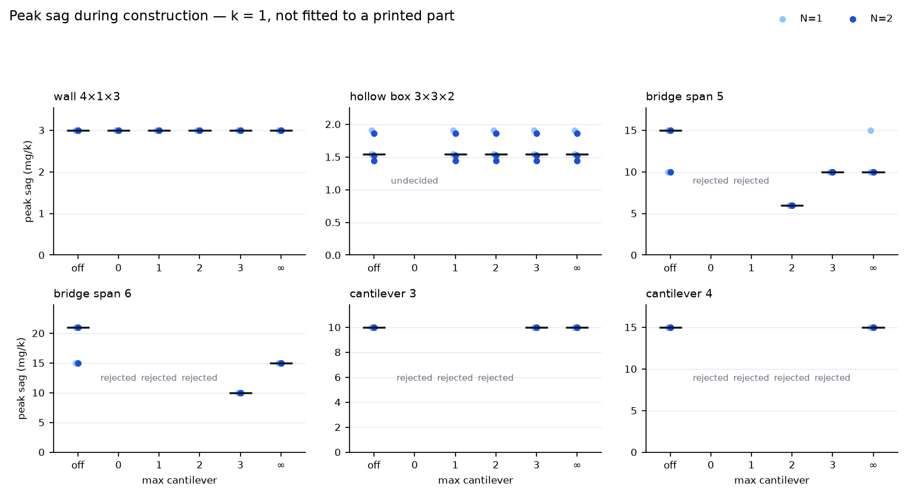

On the span-5 bridge the finished sag is 6 in every trial. With the gate off, peak sag during construction is 15 on four of the six trials and 10 on two, at both robot counts (median 15, range 10–15). The finished deck's worst overhang is 2, so limit 2 is the tightest setting that still accepts it, and all six trials then peak at 6 — the finished value, with zero singular samples. Limit 3 leaves a peak of 10 on all six. Limits 0 and 1 are proved infeasible, 6/6; the finished structure itself fails the screen. The span-6 bridge (finished sag 8) is the same mechanism one step looser. Gate off: peak median 21, range 15–21, both at N = 1 (median 21, range 15–21) and at N = 2 (median 21, range 15–21). Limit 3, the tightest feasible setting, peaks at 10 on all six. No span limit (`none`) peaks at 15 on all six. Two robots do not remove the spike: claim order can still run a deck out from one pier before the other pier props it, and that temporary tip sags past the finished span.

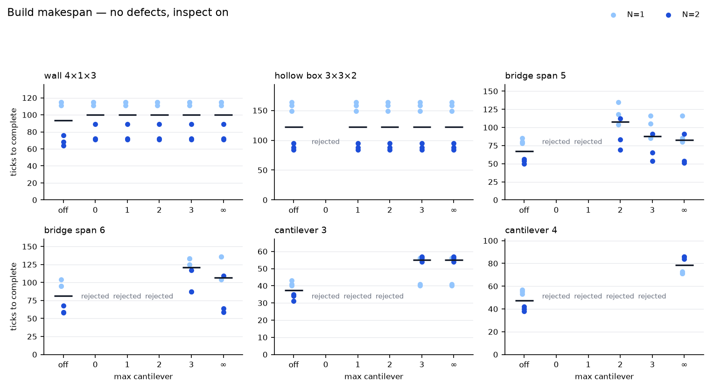

A search that finds a legal order stays on the first heuristic path, about 0.03 s (span-5 at limit 2: median 0.030 s, range 0.029–0.032, n = 6). The cost is the build, and it sits on the robot count. Span-5, gate off, zero kickbacks: N = 1 makespan median 80 (78–85), N = 2 median 54 (50–56). The same bridge at limit 2: N = 1 median 118 (104–135) with 3–6 kickbacks and 0–6 idle robot-ticks; N = 2 median 83 (69–112) with 4–26 kickbacks and 24–80 idle robot-ticks. Span-6 at limit 3: N = 1 moves from median 95 (95–104) and 0 kickbacks to median 133 (125–133) and 3 kickbacks; N = 2 moves from median 59 (58–68) and 0 kickbacks to median 87 (87–117), kickbacks 4–30, idle robot-ticks 32–90. Rejections in this campaign are finished structures past the cantilever limit, and the precheck settles them without expanding the order tree. Span-6 medians (n = 6): 0.060 ms at limit 0, 0.058 ms at limit 1, 0.057 ms at limit 2.

A pure cantilever keeps its peak once the limit is loose enough to allow the arm. Length 3 is proved infeasible at limits 0, 1, and 2 (6/6) and peaks at 10 — the finished sag — at limit 3 and at `none`, the same peak as the gate-off builds. Length 4 is proved infeasible at every finite limit (6/6) and peaks at 15 whenever it is built. What the gate removes there is singular intermediates. Every gate-off length-4 trial logged 5 sag errors (a partial build the spring network cannot tie to the base). With the connectivity rule on, that count is 0. At N = 2 the clearance costs the build: makespan 38–42 with 0 kickbacks becomes 84–86, with 15–17 kickbacks and 46–53 idle robot-ticks. At N = 1 the same arm goes from 53–57 ticks and 0 kickbacks to 71–73 ticks and 5 kickbacks.

The wall peaks at 3 in all 36 trials, gated or not. One robot takes 111–115 ticks either way, with 0 kickbacks. Two robots go from median 68 (64–76) and 0–3 kickbacks with the gate off to median 72 (71–89) and 1–7 kickbacks with the gate on. The hollow roof is the span the screen is for. The interior cell `(1, 3, 4)` is absent, so the roof center `(2, 3, 4)` has no column under it. Its overhang in the finished structure is 1, and that overhang is a lower bound on every prefix: a face-path to a grounded column that exists in a subset still exists after cells are added, and deleting cells cannot create a shorter one. Limit 0 requires every voxel to be column-supported, so the blueprint is infeasible. All 6 trials are proved rejections (median 0.0965 ms, range 0.088–0.120 ms; `docs/stability_cost_summary.txt`). The order search does not run. Before the precheck, the same 6 searches hit the 200-node cap and were undecided (median 7.12 s, range 7.09–7.15). That earlier timing is the campaign recorded in NOTES.md on 2026-10-18, not a row in the current CSV. Limits 1 and 2 both allow a lower bound of 1, so the precheck does not reject them, and the search finds an order. At every limit that allows the roof (1, 2, 3, and none), peak sag matches the gate-off runs (median 1.542, range 1.441–1.909; finished sag 1.4) and so does the makespan (N = 1 median 158, range 149–164; N = 2 median 88, range 84–95). The supported-first heuristic already raises the walls before the roof, so once the limit allows the center cell the gate has no prefix left to reorder. The screen cannot discard a blueprint the search can build: any accepted plan's finished prefix passed `is_stable`, so every lower bound was inside the limit. On random blueprints of at most 6 voxels the unscreened exhaustive search agrees, which is the check in `tests/test_stability.py`.

The four fuzz shapes repeat that split. The 2×1×2 wall stays at sag 1. The fuzz span-6 bridge matches the named one (gate-off peak 15–21, limit 3 peak 10, finished sag 8; limits 0–2 proved infeasible, n = 4). The fuzz length-3 cantilever is rejected below 3 and peaks at 10 when allowed. The ledge, tip overhang 2, is rejected at limits 0 and 1; where it is allowed the peak stays 5.25, equal to the finished sag, up to 2 singular samples disappear, and at N = 2 the gate adds 2–4 kickbacks and 18–22 idle robot-ticks. No trial in the 312 hit the node cap.

Kickbacks, idle robot-ticks, and planning seconds are charted beside the two figures above (`docs/stability_kickbacks.png`, `docs/stability_idle.png`, `docs/stability_planning.png`). Feasibility, every cell decided:

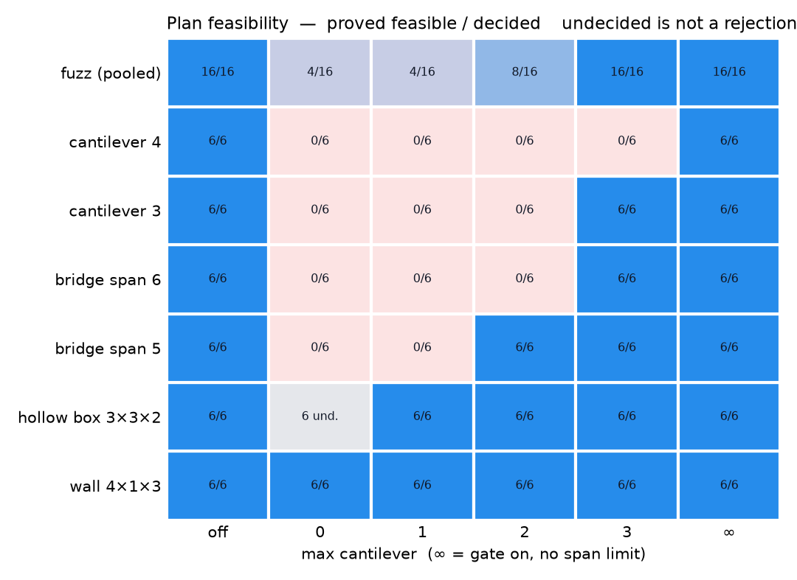

## 6.7 On-lattice robots and their weight

The default robot still stands in an empty cell and reaches out. `OnLatticeGeometry` (`sim/inchworm.py`) is the other regime, and it is off unless a caller builds it. Both feet grip exposed faces of voxels that are already placed. A tick-boundary pose has both feet down. The step moves exactly one foot. A carried voxel goes into an empty cell that shares a face with the structure, lies within `place_reach` of a foot, and is not the cell outside a foot (that placement would bury the gripper). The stance reserves both faces, so two robots that share a foot conflict in the same reservation table and the same cooperative A*.

What is taken from the papers, and what is configuration, is written at the top of `sim/inchworm.py`. Short form: BILL-E (Jenett and Cheung, AIAA 2017-1876, doi:10.2514/6.2017-1876) is a bipedal inchworm, 520 g in Table I, on the vertex-connected octahedral lattice, not on this cubic face grid. That paper does not give a voxel mass, so this section states no BILL-E mass ratio. SOLL-E (Park et al., IROS 2023, NTRS 20230011353; the transport robot in Gregg et al. 2024) is a 5-DoF bipedal inchworm. Table I gives cargoSOLL-E 4.8 kg, craneSOLL-E 4.4 kg, pitch 0.3048 m, and a voxel mass of approximately 380 g. Those are about 12.6 and about 11.6 robot-masses per voxel. They are not rows below. Link lengths are published and are not reduced here to a foot span. The campaign's stride (1 surface edge), span (face-center Chebyshev 2), place reach (1), and the choice to walk top and side faces are configuration. Convex and concave corners are enabled because both papers demonstrate them; the cubic-face edge is this model's abstraction of that maneuver, not a joint trajectory. Inverted faces stay off. Robot weight is split equally across the listed feet. Two feet on one voxel sum to the whole force. That split is not a published fraction.

The structures are small on purpose, and both modes start from the same planted seed. The cantilever is a 3-voxel arm at level 2 (finished voxels-only sag 6, overhang 2). The tower is three voxels on the first seed cell (finished sag 6, overhang 0). The bridge is a 4-voxel deck at level 2 between two planted piers (finished sag 3, overhang 1). Level-1 voxels on the ground plane are planted and do not sag; the span has to be up a level or the measurement is zero. Side faces are on, because a level change at stride 1 needs the side face as a place to stop. One robot, inspection off, no defects. Three entry seeds, so n = 3. `k = mass = g = 1`. Sag is `mass·g/k`.

The crane has no foot cells. Its mass is not applied, and a sag cap on the policy does not consult a stance. On every crane row the peak with robots and the peak from voxels alone are the same number.

Gate off, the peaks during the build are:

| shape | crane (no robot weight) | on-lattice, ratio 1 | ratio 3 | ratio 10 |
| --- | --- | --- | --- | --- |
| cantilever | 6 (n=3, 6–6); voxels 6 | 7 (7–7); voxels 6 | 9 | 16 |
| bridge | 6 (6–6); finished 3 | 9 (9–9); voxels 6 | 12 | 22.5 |
| tower | 6 (6–6); voxels 6 | 7 (7–7); voxels 6 | 9 | 16 |

Where the table gives one number for an on-lattice ratio, the three seeds agreed and the voxels-only peak stayed 6. Ratio 10 is the sweep point nearest the SOLL-E figures above. It is not those figures.

Makespan, gate off, in ticks: cantilever crane median 16 (15–16), on-lattice median 9 (8–11); bridge crane median 32 (31–32), on-lattice median 24 (21–31); tower crane median 11 (10–11), on-lattice median 10 (10–13). The inchworm starts on the seed. The crane starts in an empty ground-level cell. These are not a claim that one hardware platform is faster.

The search order and the order cells are placed are different, because the swarm claims the nearest cell inside a lookahead window. On the cantilever, gate-off crane *search* lists the tip before the middle cell, `(2,1,2)` then `(2,1,4)` then `(2,1,3)`. The place order is `(2,1,2);(2,1,3);(2,1,4)` on all three seeds. The cantilever gate and the sag gate both rewrite that search to the place order (3/3) and leave the place order alone (0/3). The on-lattice arm is that same sequence in both the search and the build, at every ratio, and neither gate moves it. The sag cap is the worst sag of the *finished* arm with one carried robot on a legal stance. On a pure cantilever that finished pose is already the worst prefix, so the cap does not reject the arm and does not reorder it. The tower is the same fact with overhang 0: bottom to top, every gate, both modes.

The bridge is where a gate changes a build. Gate-off crane search lists the far cap first. Nearest claim places the deck from the near pier outward, `(2,1,3);(2,1,4);(2,1,5);(2,1,6)`, and the peak is 6, twice the finished sag of 3. The cantilever gate, set to the finished overhang of 1, refuses the cell two steps out before the far cap exists. The search order does not change. The place order does, 3/3: `(2,1,3);(2,1,4);(2,1,6);(2,1,5)`. The peak falls to 3, the finished value. Makespan moves from median 32 (31–32) to median 45 (44–45). The crane sag gate does not do this. With no feet, the cap is never applied, and the place order and the peak stay with the gate-off build.

The inchworm cannot walk the floor to the far pier. Its only order grows the deck from the seed, and the peak with a robot on that one-sided prefix is 9, 12, or 22.5 at ratios 1, 3, and 10, against a voxels-only peak of 6 and a finished sag of 3. The cantilever gate and the sag gate each reject that order, 3/3 seeds, at every ratio. There is no alternative order for them to substitute. Eighteen of the 108 trials are that rejection. The other 90 complete. None hit the node cap. Completed trials logged 0 sag errors: every sampled partial build was tied to a planted voxel.

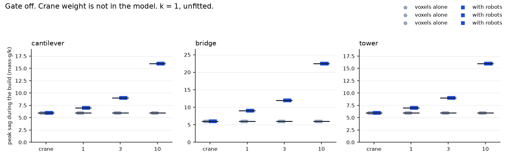

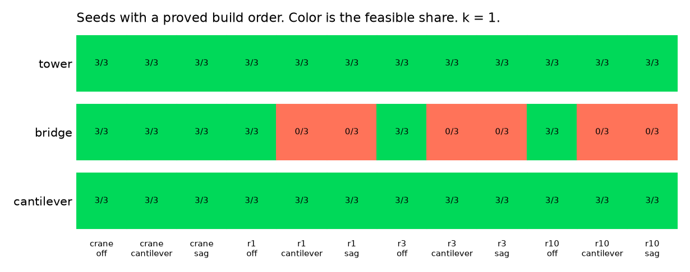

Makespan for the same cells is `docs/on_lattice_makespan.png`. Raw rows are `docs/on_lattice.csv`. Reproduce with `python main.py onlattice`.

The still below is the cantilever at ratio 3, after the build, with both feet on adjacent top faces of the arm. Displacement color includes the robot loads. The picture is true geometry: the blocks sit on the cells where they were placed. `docs/on_lattice_sag.png` is the same frame with exaggeration at 0.20 of a voxel pitch, normalized and capped at 0.40, so the arm does not pass through the voxels under it. The feet sit on the faces that were drawn. `k = 1`.

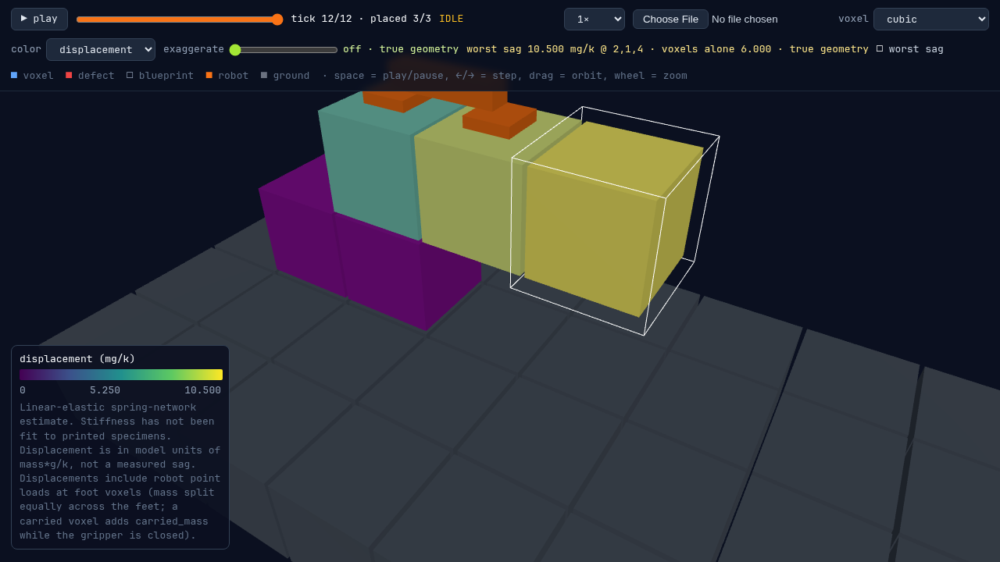

## 6.8 Scaffold on bridges of span 4–8

`python main.py scaffold` plans each span once per gait, then builds that plan with a swarm. 90 trials: spans 4–8, the crane and the on-lattice inchworm from §6.7, three robot counts, start seeds {0, 1, 2}. The count is `n_robots = max(1, round(n_voxels / divisor))` for divisor ∈ {1, 3, 10}. That is a headcount. It is not the robot-mass / voxel-mass ratio in §6.7. A span of pier-gap `s` has `s + 3` voxels (two piers and `s + 1` deck cells). 88 of the 90 finished: blueprint complete, no scaffold left. Two hit the 4000-tick cap and are named with the table. Python 3.12.3. Raw rows: `docs/scaffold_campaign.csv`.

The inchworm does not walk empty ground. It enters on a planted level-1 pad: every open level-1 cell in a column left of the near pier, plus the cells in the pier's column that are not the pier and not under the deck. Nothing is planted in a column under the span. The pad is not scaffold, and it stays after the supports come out. The caps are the blueprint plus that pad. On these five spans the pad does not move the overhang or the finished sag, so the crane, which has no pad, and the inchworm share the numbers below.

Caps are that finished structure. `max_cantilever` is the tightest integer that accepts it. `max_sag` is its `worst_sag` at `k = mass = g = 1`, in units of `mass·g/k`. Stiffness has not been fit.

| span | voxels | cantilever | finished sag (mass·g/k) |
| --- | --- | --- | --- |
| 4 | 7 | 2 | 4.5 |
| 5 | 8 | 2 | 6 |
| 6 | 9 | 3 | 8 |
| 7 | 10 | 3 | 10 |
| 8 | 11 | 4 | 12.5 |

The crane (`reach_radius=4`, `stride=1`, `climb=0`) walks the floor of the unmodified bridge. It needs no scaffold on any of these spans: a placement order already stays inside both caps. The inchworm's plain plan is rejected. The supports that make an order are level-1 cells under the deck. Span 4 needs three: `(1, 2, 4)`, `(1, 2, 5)`, and `(1, 2, 6)`. Spans 5 through 8 need two: span 5 `(1, 2, 4)` and `(1, 2, 6)`; spans 6 and 7 `(1, 2, 5)` and `(1, 2, 7)`; span 8 `(1, 2, 5)` and `(1, 2, 8)`. One column is not enough for this gait. A foot places only into a face-adjacent empty cell, so the next support has to be reached from structure that already exists, and the cantilever cap stops the deck short of the far pier unless another column is already in reach. Span 4's sag cap of 4.5 also refuses one-column prefixes that the cantilever limit alone would still allow. Removal of those cells, in the order the search returns, stays inside the same caps.

`sequence_cost` is the search's tie break after the count. Makespan below is swarm ticks, min–max over the seeds that finished, with kickbacks in parentheses.

| span | gait | scaffold | cost | ratio ~1 | ratio ~1/3 | ratio ~1/10 |
| --- | --- | --- | --- | --- | --- | --- |
| 4 | crane | 0 | 71 | 56–65 (61–68), N=7 | 60–72 (11–14), N=2 | 72–76 (2), N=1 |
| 4 | inchworm | 3 | 85 | 137–166 (136–162), N=7 | 127–139 (9–12), N=2 | 163–169 (0), N=1 |
| 5 | crane | 0 | 88 | 60–115 (67–142), N=8 | 84–88 (29–42), N=3 | 86–101 (2–3), N=1 |
| 5 | inchworm | 2 | 92 | 211–226 (315–333), N=8 | 208–228 (69–82), N=3 | 179–185 (0), N=1 |
| 6 | crane | 0 | 105 | 106–124 (168–261), N=9 | 109–128 (49–71), N=3 | 131–142 (4–8), N=1 |
| 6 | inchworm | 2 | 121 | 274–302 (480–547), N=9, 2 of 3 seeds | 263–286 (103–114), N=3 | 232–238 (0), N=1 |
| 7 | crane | 0 | 122 | 118–130 (227–346), N=10 | 112–164 (48–88), N=3 | 144–192 (4–10), N=1 |
| 7 | inchworm | 2 | 138 | 276–290 (551–597), N=10 | 279–287 (87–99), N=3 | 277–283 (0), N=1 |
| 8 | crane | 0 | 139 | 146–184 (340–452), N=11 | 148–183 (109–140), N=4 | 182–209 (5–10), N=1 |
| 8 | inchworm | 2 | 165 | 356–360 (796–876), N=11 | 344–350 (212–225), N=4, 2 of 3 seeds | 330–336 (0), N=1 |

Span 6 with 9 inchworms, seed 2, was still unfinished at tick 4000 (11046 kickbacks). Span 8 with 4 inchworms, seed 2, was the same (4291 kickbacks). Those two rows are not in the ranges above. The other seeds of those cells did finish. 88 completed, 2 hit the cap, 0 were left undecided by the node budget.

More robots do not remove the scaffold, and the tick count does not fall in proportion to the robot count. Kickbacks rise. On the span-5 crane the one-robot makespan is 86–101 and the eight-robot makespan is 60–115. Span-5 crane seed 2 finishes in 86 ticks against a `sequence_cost` of 88: the score charges a final return to the depot, and the swarm stops when the last block is down. The inchworm's measured ticks sit above that score. The score is a stride heuristic on stance centers. It does not count waiting, kickbacks, or the extra steps of a two-foot gait.

Planning time for one (span, gait) pair was 0.59–1.46 s for the crane and 32–185 s for the inchworm on this machine. That is wall-clock, not a tick count.

The pictures are the span-5 inchworm, one robot, material color unless noted, deformation off. The yellow blocks are the scaffold cells `(1, 2, 4)` and `(1, 2, 6)`. Blueprint voxels and the entry pad are blue. After removal the deck is unchanged and the yellow cells are gone. In displacement color the blueprint voxels take the strain ramp and the scaffold stays yellow. k = 1. The boxes are the viewer's 0.96 size, so neighboring cells do not occupy the same space. These frames were checked as pixels: the yellow scaffold does not share pixels with the blue voxels, and that yellow is absent after removal.

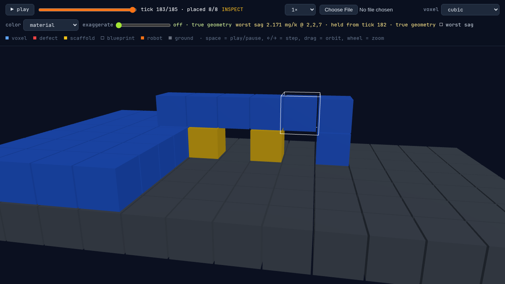

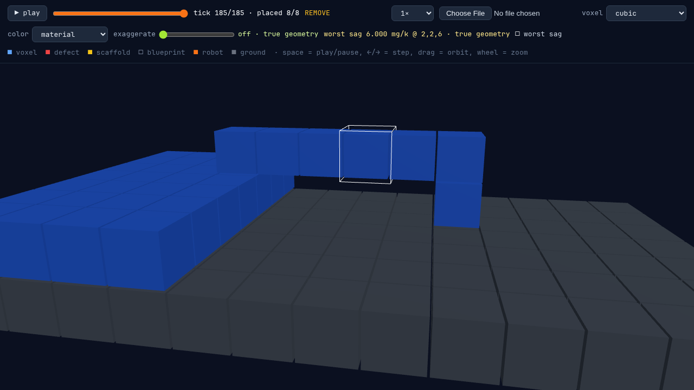

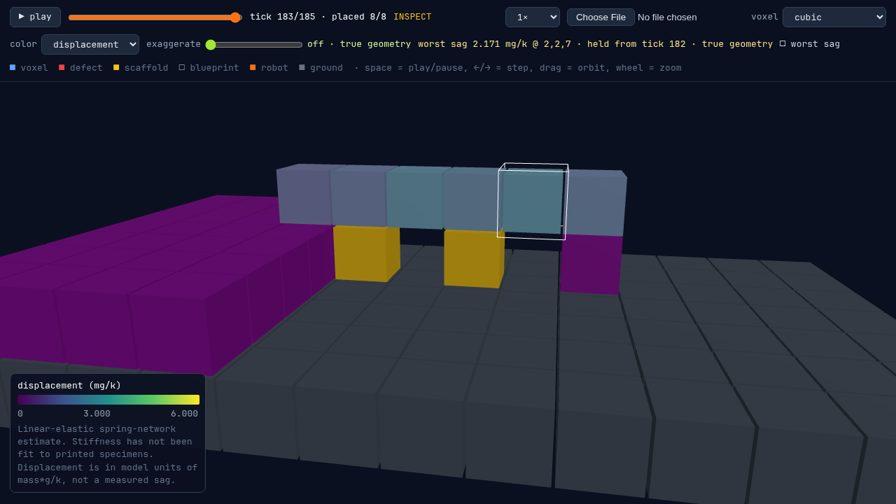

## 6.9 Shelter throughput

`python main.py armadas` schedules the 256-voxel shelter from Gregg et al., *Science Robotics* 9, eadi2746 (2024), doi:10.1126/scirobotics.adi2746. The quotations below were checked against the NTRS distribution of that manuscript (20230005194). This is not the cooperative-A* choreographer and not a SOLL-E joint trajectory. Cargo, crane, and fastening robots do not reserve lattice cells against each other. The only shared exclusion is the feed station. The structural gate is on. Every prefix of the placement order passes `is_stable` and `estimate_sag` at `k = mass = g = 1`, and the schedule will not place a cell that leaves those caps. Sag is in units of `mass·g/k`. Stiffness has not been fit.

The manuscript does state the following. The laboratory build is 256 voxels, bounding-box edge 304.8 mm. The cumulative assembly time with pauses removed is "approximately 100.4 hours or 4.2 days." `4.2 × 24 = 100.8`, so the two clocks in that sentence are not the same number. `256 × (304.8 mm)³` divided by either clock rounds to the reported 20,000 mm³/s. Three roles: cargo SOLL-E carries a voxel from the pickup, crane SOLL-E takes it off the cargo robot and places it, and MMIC-I fastens the new cell. The crew in the laboratory was two transport robots and one fastening robot. Voxels were loaded "at the beginning of the seed structure." The planner's depot is "the depot node d." Per-voxel time "depends on the distance the voxel needs to be transported from the voxel pick up location." The same section names the future work this sweep is: "increased robot speed, more efficient path planning, multiple feed stations, parallelization, and more." It does not print the words "1 feed station." The single-station case is that one pickup. The seed is five voxels. Capture envelopes in the body text: petals 3.0 cm in-plane, external grippers 1.34 cm out-of-plane, placement within ±1.78 cm and ±3°, skis ±1.78 cm in-plane enforcing <0.1 mm when extended, claws 1.34 cm out-of-plane. The body text says the claws enforce <0.1 mm at full grip. The Fig. 4 caption says <0.2 mm in Y. Fastener actuation accommodates up to 0.2 cm in Y. The schedule places cells on grid centers. §6.11 is the placement-error Monte Carlo on those same envelopes. The 42.972 h clock is the grid-center schedule.

What the manuscript does not give is marked config. No per-action duration in seconds is in the text. The main text points at fig. S7 for the per-voxel clock, and the methods section points at Figure S4 for the same claim. The curves are not in the PDF, and this section does not pick a winner. Park et al., IROS 2023 (NTRS 20230011353), the transport-robot paper Gregg cites, says one unit step took "on the order of 20 seconds" on the earlier 164-voxel test. That is the configured step. It is not a Gregg 2024 stopwatch value. Feed loading, the handoff, the placement, and one fastening action per joint have no reported duration. Each is 20 s, the same quantum as the step, so the model has one timescale. Those four were set before the sweep and were not edited after looking at the makespan.

The cell list is not Fig. 5. That figure is a photograph and two CAD views. There is no coordinate table. The stand-in is an open-front shed: an 8 by 7 floor at level 1, walls on the left column, the right column, and the back row at levels 2–5, a roof at level 6 with a one-cell eave on the open side, and a second roof course at level 7 over the footprint only. The second course is how the count lands on 256. It is not a published layer count. The seed is five collinear floor voxels at the open front. At 304.8 mm the box is 2.438 m by 2.134 m by 2.134 m. Finished overhang is 4. Finished sag is 48.7104, and the peak along the gated order is the same number. The laboratory robot bolted 596 faces. This shed has 534 new joints (the seed's four joints start closed). A voxel is support only after its own joints are fastened, and each of those joints is a separate task.

One feed and one robot of each role finishes in **42.972 h**. That is 0.428 times the printed 100.4 h. It is not a fit. Cargo utilization is 0.925, crane 0.202, fastening 0.206, and the feed station 0.032. The binding pool is the cargo robot. Cargo walks 5593 Manhattan steps, 1.70 km at the published pitch. The manuscript's cargo robot traveled 3.15 km (4624 body lengths). Crane and fastener each walk 1062 steps, 0.324 km, against the published 0.356 km and 0.230 km. A second joint on a cell the fastener is already standing on adds no step. Manhattan on this stand-in is not that center-of-gravity sum.

The sweep is 1–4 feed stations by 1–6 robots of each role, 24 runs. Makespan in hours, then the binding constraint. "Chain" means no pool is above utilization 0.5: the voxel is waiting on supports that are not fastened yet. Raw rows are `docs/armadas_sweep.csv`.

| feeds | 1 robot | 2 | 3 | 4 | 5 | 6 |
| --- | --- | --- | --- | --- | --- | --- |
| 1 | 42.97 cargo | 32.91 cargo | 32.34 chain | 32.14 chain | 32.26 chain | 32.26 chain |
| 2 | 41.28 cargo | 31.07 cargo | 30.82 chain | 30.59 chain | 30.69 chain | 30.69 chain |
| 3 | 40.02 cargo | 29.42 cargo | 29.37 chain | 29.13 chain | 29.28 chain | 29.28 chain |
| 4 | 39.15 cargo | 28.54 cargo | 28.36 chain | 28.02 chain | 28.24 chain | 28.24 chain |

A second robot of each role is the large cut, 42.97 h to 32.91 h on one feed. From three robots on, the label leaves the cargo pool. Four robots on one feed reach 32.14 h. Five and six do not improve that row (32.26 h). Feed utilization stays between 0.009 and 0.043 in all 24 runs. The station is in the model: one cargo loads at a time, and anyone else waits. On this shed, with a 20 s load and trips of many steps, the station is idle. Extra stations still shorten the makespan, to 28.02 h at 4 feeds and 4 robots, because those pickups sit further along the apron and the walk gets shorter. That is not saturation. A four-voxel floor with the load set to 10 s and the step to 1 s does saturate one station, and the label moves off the station when four stations are open. That case is a unit test of the queue. It is not a row in the CSV, and those durations are not the shelter's.

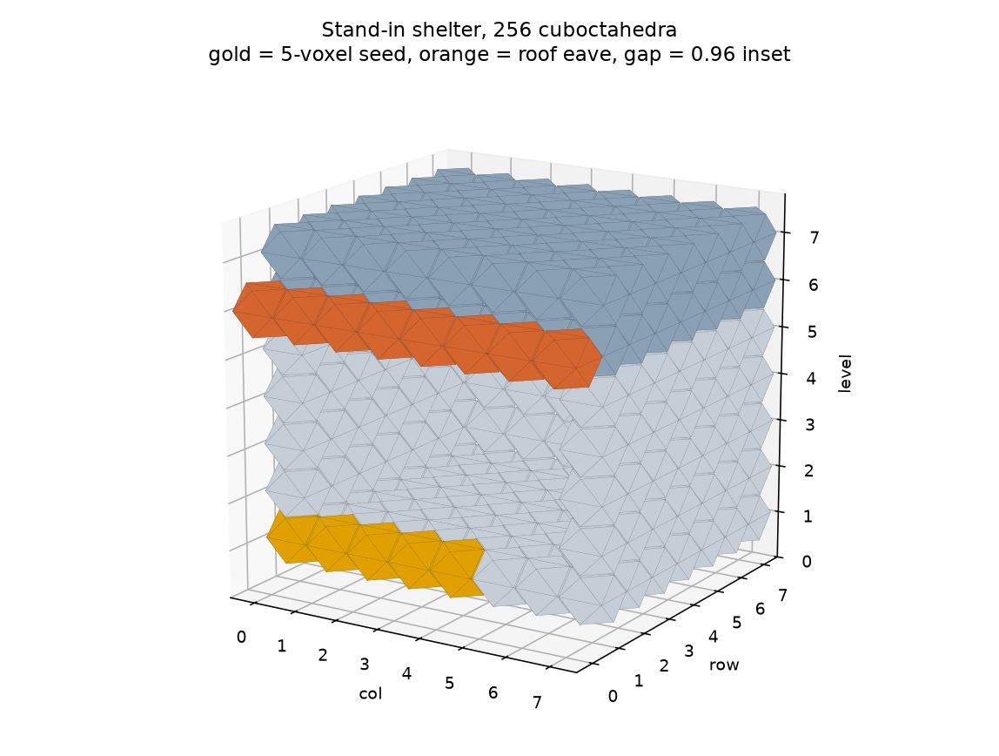

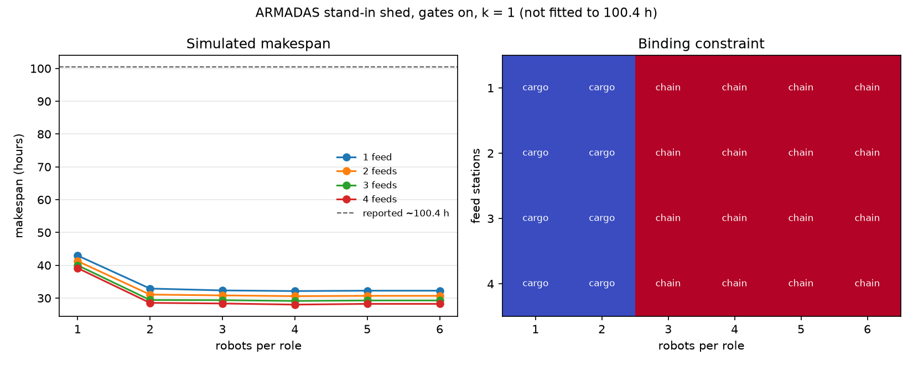

## 6.10 Joint-limited and sag-limited builds

`python main.py joints` solves the same spring network at `k = mass = g = 1` and reports the peak sag (`mass·g/k`) and the peak compression, tension, and shear (`mass·g`). A half-cap sets one component to half its finished demand and leaves the others unchecked. The row is joint-limited in that component when the half-cap rejects it, and sag-limited when the half sag cap rejects it. The ARMADAS newton capacity from §3.5 is printed in `docs/joint_limits_summary.txt` and is not a cap on these rows. Raw rows: `docs/joint_limits_demands.csv`, `docs/joint_limits_scaffold.csv`, `docs/joint_limits_members.csv`.

Finished demands. A clamp bar is a finite base under one root, so the stock floor does not plant the course. A bridge uses the stock ground plane. "One-sided" drops the far pier.

| build | sag | compression | tension | shear | half-cap that rejects |
| --- | --- | --- | --- | --- | --- |
| clamp cantilever n=3 | 6 | 0 | 0 | 3 | shear, sag |
| clamp cantilever n=6 | 21 | 0 | 0 | 6 | shear, sag |
| clamp cantilever n=3, tip load P=2 | 12 | 0 | 0 | 5 | shear, sag |
| clamp tower n=3 | 6 | 3 | 0 | 0 | compression, sag |
| clamp tower n=6 | 21 | 6 | 0 | 0 | compression, sag |
| bridge span 4 | 4.5 | 2.5 | 0 | 1.5 | compression, shear, sag |
| bridge span 4, one-sided | 15 | 5 | 0 | 4 | compression, shear, sag |
| bridge span 5 | 6 | 3 | 0 | 2 | compression, shear, sag |
| bridge span 5, one-sided | 21 | 6 | 0 | 5 | compression, shear, sag |
| bridge span 6 | 8 | 3.5 | 0 | 2.5 | compression, shear, sag |
| bridge span 6, one-sided | 28 | 7 | 0 | 6 | compression, shear, sag |
| ARMADAS shelter, 256 cells | 48.7104 | 10.344 | 0.0934695 | 3.164 | compression, shear, sag |

The cantilever is shear-limited. Compression is ~0, so a compression cap does not reject it. The tower is compression-limited. Shear is ~0. The tip load `P = 2` raises root shear from 3 to 5 and tip sag from 6 to 12, which is the closed form `weight·(n−i+1) + P`. Bridges and the shelter are limited by all three: compression, shear, and sag. On the shelter the largest model-unit demand is sag, then compression, then shear. The small tension is the eave. No tension capacity is set, so it is not gated. No scaffold search is run on 256 cells.

Scaffold counts, same caps the campaign uses (finished overhang and finished `worst_sag`), plus a joint cap. "At finished" sets compression and shear to the finished demand. "Mid-gap" sets shear to the average of the finished shear and the one-sided shear, and compression to the finished compression. "Half" scales both by 0.5. A count is scaffold voxels. Infeasible means the search returned `None`.

| span | gait | sag only | joint at finished demand | mid-gap | half the finished demand |
| --- | --- | --- | --- | --- | --- |
| 4 | crane | 0 | 0 | 0 | infeasible |
| 5 | crane | 0 | 0 | 0 | infeasible |
| 6 | crane | 0 | 0 | 0 | infeasible |
| 4 | inchworm | 3 | 3 | 3 | infeasible |

A cap at the finished demand does not add scaffold. A balanced crane order, and the propped inchworm order, stay at or under that demand, and the search stops at the sag-only count. The one-sided deck shears more than the finished beam (span 4: 4 against 1.5), and that prefix fails the finished-demand cap. The crane has another order, so its count stays 0. The inchworm on span 4 still needs the same 3 posts it needed for sag. A cap at half the finished demand rejects the blueprint itself. Scaffold is removed at the end, so it cannot rescue that rejection. The count goes from the sag-only number (0 for the crane, 3 for the inchworm on span 4) to infeasible. It does not step up.

The same pattern on members the crane can stand beside. The level-2 arm is `build_cantilever`. The towers use a reach-8 arm with `climb = 0`. Reach 4 cannot touch the top of a 6-voxel tower, and that refusal would be reach, not joints. Shear on these towers is 0, so the half-cap that rejects them is compression.

| build | sag | compression | shear | sag only | at finished demand | half |
| --- | --- | --- | --- | --- | --- | --- |
| level-2 cantilever, length 3 | 10 | 4 | 3 | 0 | 0 | infeasible |
| level-2 cantilever, length 6 | 28 | 7 | 6 | 0 | 0 | infeasible |
| tower, n_free=3 | 6 | 3 | 0 | 0 | 0 | infeasible |
| tower, n_free=6 | 21 | 6 | 0 | 0 | 0 | infeasible |

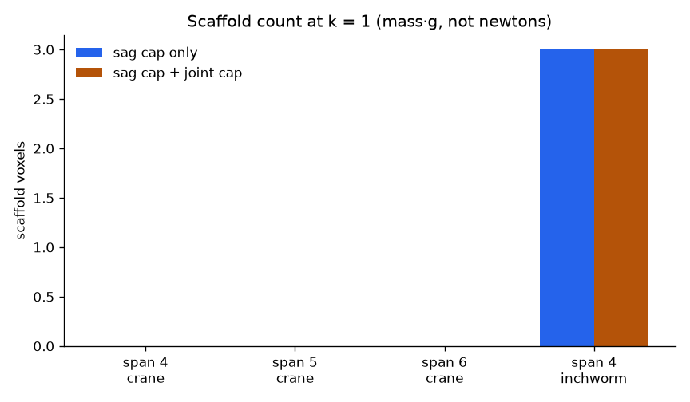

The stills are deform off, so each box is the 0.96 cube on the cell where it was placed. Neighbors keep a gap. Capacities on a finished build are that build's own peak demand, so the worst joint sits at utilization 1. The one-sided frame shares the finished bridge's capacities and the same color scale.

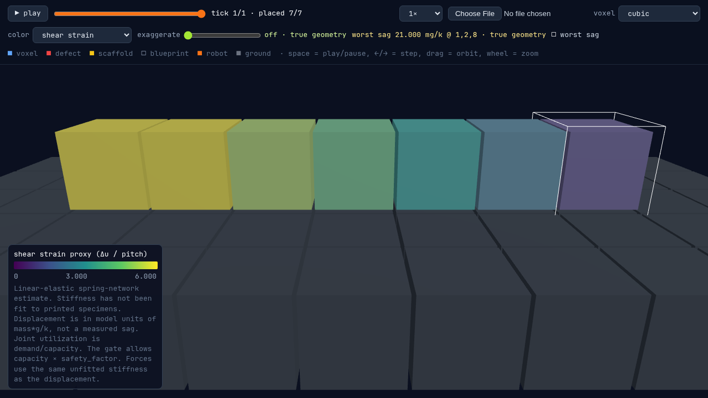

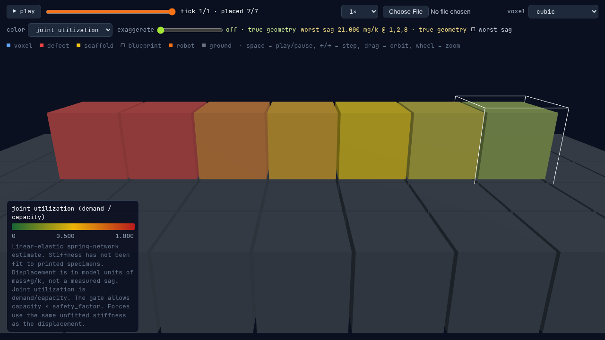

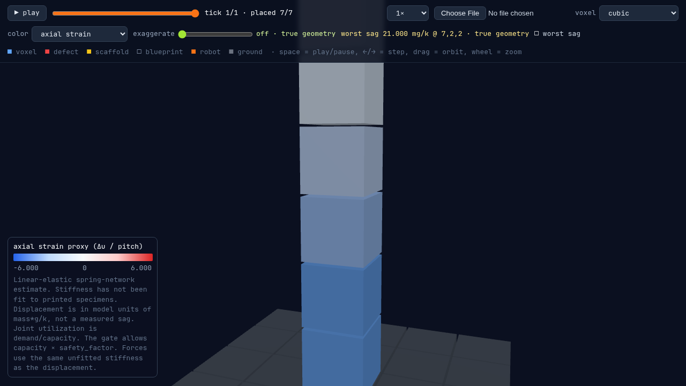

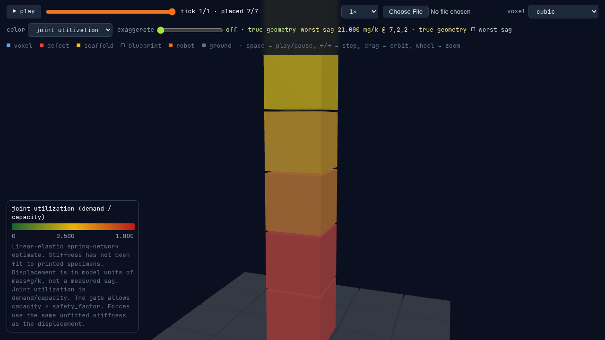

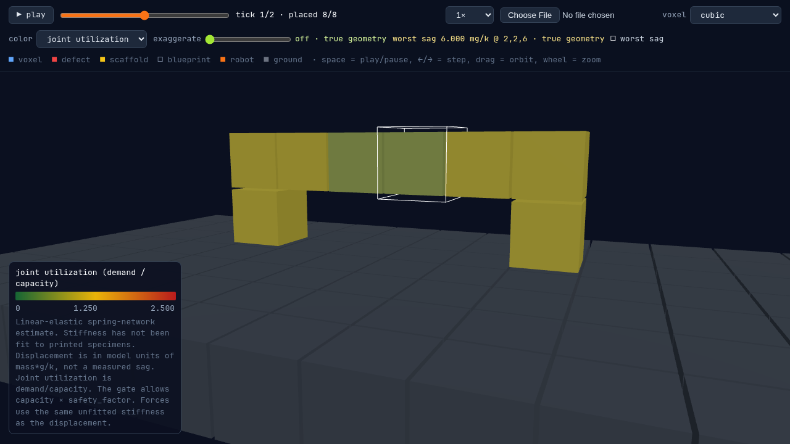

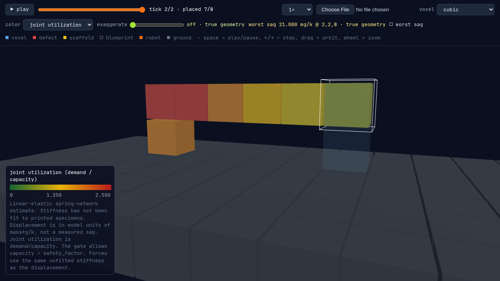

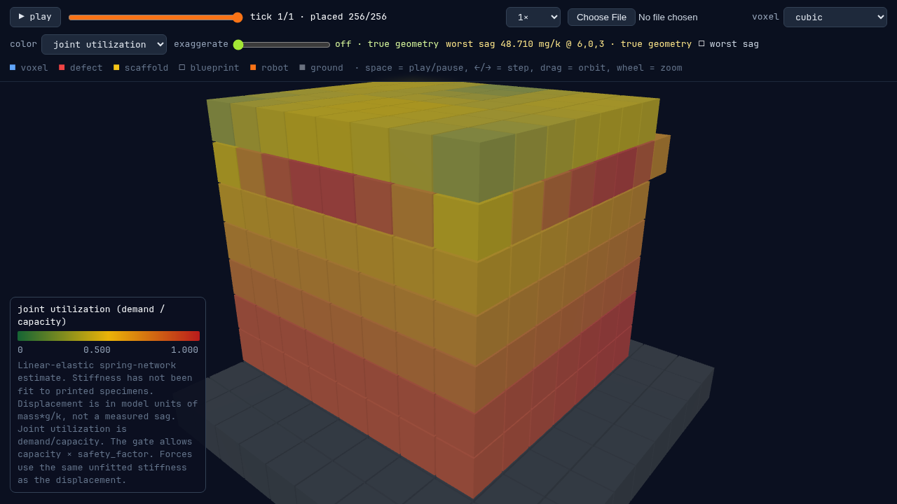

## 6.11 Placement error versus size

`python main.py precision` runs the model of §3.6. The distribution is uniform inside ±1.78 cm and ±3°. That is the requirement box, not a measured histogram. Capture is the ski at ±1.78 cm in-plane and the claw at 1.34 cm out-of-plane. The angle gate is the same ±3°. Snap is the exact elastic average. The printed <0.1 mm bound is not sampled. Stiffness is not an input. Raw rows: `docs/precision_campaign.csv`. The summary is `docs/precision_summary.txt`.

Geometries. A cantilever of length `n` is a datum at the origin and `n` free cells along +col. A bridge of pier gap `s` has two datum piers and a deck of `s + 1` cells one level up, placed left to right; the far cap mates to the deck and to the far pier. The shelter is `shelter_model()`, 256 cells, and the surface is the level-7 roof fit to a plane. A chain and a deck are fit to a line. Seeds are the integer `1_000_003·kind + 1_009·size + 97·mode + 13·scale + index`, not `hash()`. Beams use 40 seeds. The shelter uses 16. A miss is retried up to 40 times. "Complete" means every cell received a pose. On the open loop that is every seed, and the far cap can still sit off the pier. On gate-without-snap, a cell that never captures stops the walk, and the tip of an unfinished bridge is absent.

Closed forms, snap on, parents returned to the ideal grid. Every cantilever cell has one normal, so the analytic miss rate is 0.247191 at every length. A bridge of gap `s` has `s` single-normal cells and one two-normal cap, over `s + 1` deck cells: 0.284409, 0.273775, 0.267867, 0.261505, and 0.258137 at gaps 4, 6, 8, 12, and 16. The shelter mixes one-, two-, and three-normal cells and the analytic rate is 0.431871. Scale 0.5, both envelopes inside the box: cantilever 12 is 0.905899, bridge 8 is 0.908483, shelter is 0.928984. Scale 2 is 0.

Cantilevers, n = 40, scale 1. Position RMS and the tip are meters. The snap RMS column is the median; on these rows the min and the max are that same value, float noise on an exact seat. The open-loop columns are median (min–max).

| free | snap fail | analytic | snap RMS | open-loop RMS | open-loop tip | gate, no snap |
| --- | --- | --- | --- | --- | --- | --- |
| 3 | 0.281437 | 0.247191 | 0 | 0.0246546 (0.0104096–0.0493948) | 0.0283784 (0.00885088–0.0721015) | 40/40 |
| 6 | 0.256966 | 0.247191 | 9.06493×10⁻¹⁷ | 0.0378961 (0.0178445–0.0823002) | 0.0563515 (0.00550427–0.146962) | 40/40 |
| 12 | 0.253499 | 0.247191 | 2.31111×10⁻¹⁶ | 0.0790482 (0.0219288–0.154033) | 0.134963 (0.0230804–0.275039) | 40/40 |
| 24 | 0.261538 | 0.247191 | 1.00637×10⁻¹⁵ | 0.237581 (0.067039–0.605463) | 0.404698 (0.0999236–1.14619) | 40/40 |

All 160 snap trials seat every cell. The largest snap RMS in the table is 1.00637×10⁻¹⁵ m. The printed claw residual is <0.1 mm (10⁻⁴ m). This model does not sample that residual; the table is roundoff. The open-loop tip median rises from 0.0284 m at 3 free cells to 0.405 m at 24. A translation-only walk, angle held at 0, has tip RMS `0.0178 √n` meters, which is 0.0872 m at n = 24. The campaign draws the ±3° angle, and 0.405 m is larger than 0.0872 m. The angle is the larger term. The 0.0872 m figure is that formula, not a row. Line-fit surface RMS, open loop, median: 0.00432991, 0.0092679, 0.0174695, and 0.0400529 m. Gate-without-snap finishes all 40 seeds at each length. Its position RMS sits next to the open loop, because truncating the ±1.78 cm box removes little once the angle is in the draw.

Bridges, n = 40, scale 1. Snap seats 40/40 at every gap, and the snap RMS is 0 at gaps 4 and 6 and at most 4.72565×10⁻¹⁶ m at gap 16.

| gap | snap fail | analytic | open-loop RMS | open-loop tip | gate, no snap complete |
| --- | --- | --- | --- | --- | --- |
| 4 | 0.270073 | 0.284409 | 0.0346746 (0.0132737–0.0819323) | 0.0423545 (0.0165563–0.121145) | 11/40 |
| 6 | 0.274611 | 0.273775 | 0.0454342 (0.0237611–0.110246) | 0.0682153 (0.0280428–0.174331) | 3/40 |
| 8 | 0.278557 | 0.267867 | 0.0648238 (0.0195068–0.222349) | 0.110119 (0.0161754–0.372614) | 1/40 |
| 12 | 0.281768 | 0.261505 | 0.102293 (0.0470025–0.24083) | 0.17783 (0.0860838–0.443734) | 0/40 |
| 16 | 0.254386 | 0.258137 | 0.148438 (0.054825–0.305612) | 0.267674 (0.0463302–0.633644) | 0/40 |

The snap miss rate stays on the closed form. The open-loop tip median grows from 0.0424 m to 0.268 m: the far cap is placed, and it is not on the pier. Gate-without-snap completion falls from 11/40 at gap 4 to 0/40 at gaps 12 and 16. The pooled fail rate on those unfinished walks (0.884 at gap 4, 0.739 at gap 16) counts the 40 exhausted retries on the cell that never captured. It is not the 0.25 closed form, which assumes parents have snapped back to the grid. Line-fit surface RMS, open loop, median: 0.00860494, 0.0110207, 0.0134587, 0.0175498, and 0.0261237 m.

Shelter, 256 cells, n = 16, scale 1. Snap: 16/16 complete, pooled fail 0.445993 against analytic 0.431871, position RMS 1.54804×10⁻¹⁶ m on every trial, roof-plane RMS median 8.88178×10⁻¹⁶ m. Open loop: 16/16, position RMS median 0.116778 m (0.0895975–0.161128), tip median 0.0770202 m (0.043772–0.163596), roof-plane RMS median 0.0474251 m. Gate-without-snap: 0/16 complete. The IEEE Aerospace 2024 average of 0.0041 inches on an 8 m truss is a strut-length ABAQUS result. It is not a target for this roof, and the two error sources are different.

Envelope scale, snap on. The draw box stays ±1.78 cm and ±3°. Only the ski and the claw move.

| structure | n | scale 0.5 fail (analytic) | scale 1 | scale 2 |
| --- | --- | --- | --- | --- |
| cantilever 12 | 40 | 0.905412 (0.905899) | 0.253499 (0.247191) | 0 (0) |
| bridge 8 | 40 | 0.910537 (0.908483) | 0.278557 (0.267867) | 0 (0) |
| shelter 256 | 16 | 0.919228 (0.928984) | 0.445993 (0.431871) | 0 (0) |

Halving the envelopes takes the miss rate from about a quarter (about 0.43 on the shelter) to about 0.91. Doubling them takes it to 0, which is the closed form once both envelopes contain the box. Snap RMS stays at the same numerical zero in every cell of this table. The correction envelope decides whether a voxel seats. Once it seats, the snap, not the envelope width, is what zeros the position error.

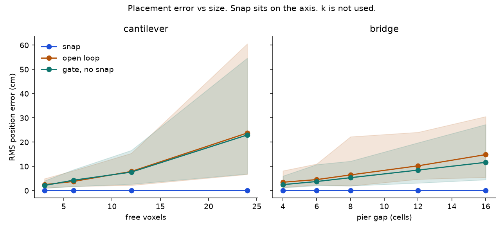

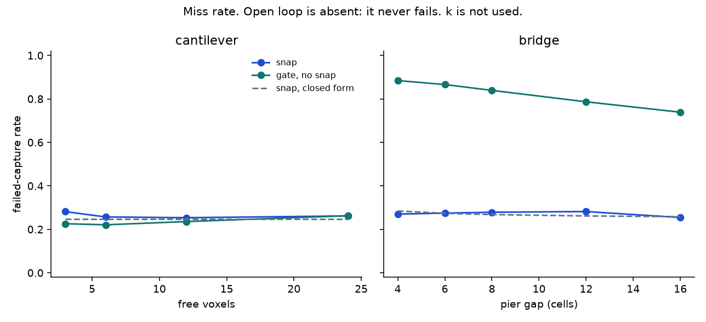

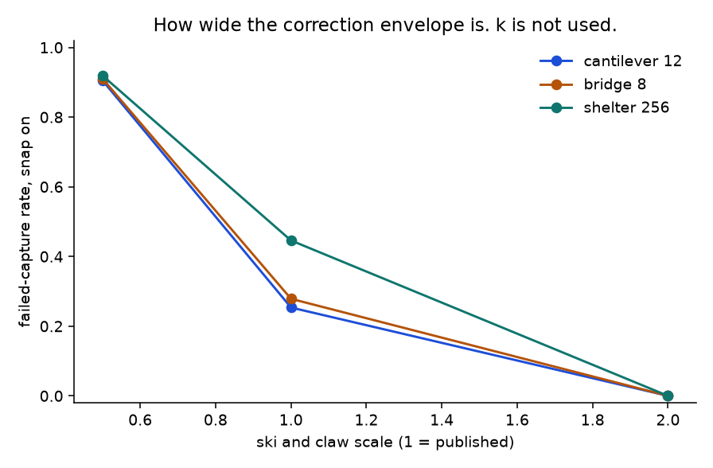

The still is one cantilever, 12 free voxels, seed index 30, transverse axis y, factor 1 (true scale; the wander is larger than a fifth of the 0.3048 m pitch, so nothing is multiplied). Open-loop position RMS on that seed is 0.147395 m. Snap RMS is 2.31111×10⁻¹⁶ m. The left panel is the open loop: an amber datum at the origin, blue free voxels stepped along the chain, gray ideal outlines, and a visible transverse wander with a gap between boxes. The right panel is the snap: the same amber datum and twelve blue voxels on those outlines, collinear, gaps intact. The title says this is not sag. k is not used.

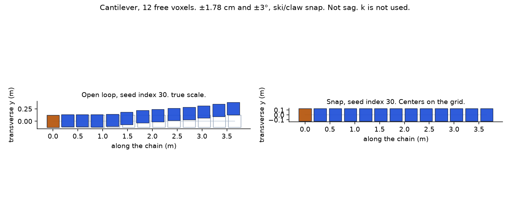

## 7. Interchange format and tooling

Every run emits one JSON log (versioned contract, documented in-source): world dimensions, legend, blueprint, and per-tick occupancy plus per-robot position/state/carry. A crane snapshot is exactly those three fields. An on-lattice snapshot adds `feet` (cell and outward normal) and `locomotion: "inchworm"`. `pos` stays the first foot's voxel so an older reader still has a cell; the viewer has to prefer `feet`, or it draws the robot inside that voxel. When `StructureLog` is given a positive `robot_mass`, samples include the foot loads and also store `worst_sag_voxels` for the same occupancy with the robots omitted. Three versions are live (v1 single-robot 2D; v2 multi-robot; v3 3D), all consumed by the same zero-build Three.js replay viewer (drop a log in; play/scrub/orbit) and by the chart pipeline. A run that opts in with a `StructureLog` also stores, on sampled placements, the sag estimate's per-voxel displacement and a per-joint axial/shear strain proxy, plus the spring force in the force unit of that solve (`mass·g` at the defaults, newtons only when `si=True`). When the log was given a `JointStrength`, each joint also stores utilization (demand/capacity) and the sample stores the worst joint. The viewer can color from those samples, including a green–amber–red utilization ramp scaled to the larger of the peak and the safety factor. Scaffold stays construction yellow in that mode too. It draws the as-built cells unless exaggeration is turned on, in which case the longest arrow is a fraction of the voxel pitch (capped at 0.4) and the picture is labeled exaggerated and normalized. Inchworm feet are placed on those drawn faces. A scaffold voxel is occupancy `SCAFFOLD` and is drawn construction yellow (`#f5c518`) in every color mode, including displacement, so it is not painted with the strain ramp. The box is the same 0.96 size as a blueprint voxel. Logs written before that legend key omit it; the viewer does not treat a missing key as scaffold. Logs that omit the samples are unchanged, and the colors are the uncalibrated spring model (stiffness has not been fit to a printed specimen). A 3D log may set `meta.voxel_shape` to `cuboctahedral` (§3.3). The viewer then draws cuboctahedra, and a menu can switch the solid back to boxes. Logs that omit the key, including every cubic run and every log from before the field existed, still draw cubes. The toggle does not change the recorded occupancy. The log is the integration point for higher-fidelity validation: a community-requested USD/Isaac Sim exporter (listed in CONTRIBUTING) would replay itineraries against articulated robot models — fidelity layered *above* the discrete source of truth, which is where relative-robot systems locate their ground truth (the lattice is the metrology).
## 8. Related work

**ARMADAS** [Gregg et al., *Science Robotics* 2024; planning supplementary NTRS 20250002467] is the closest published system and our provenance anchor: cooperative/multi-label A\* over time-expanded pose graphs with node reservations and storage-location deadlock-freedom. Our stack is a clean-room implementation from the published descriptions (no ARMADAS code exists to consult); lease/deed is our vocabulary for machinery their framework implies. **TERMES** [Werfel et al. 2014] compiles structures into local rules — search-free coordination purchased by restricting buildable structures to single-path additive orders; our gates + search remove that restriction at the cost of computation, and TERMES's documented failure classes ground two of our fixtures. **MAPF**: cooperative A\* descends from Silver's prioritized planning; optimal solvers (CBS/ECBS, e.g. libMultiRobotPlanning) are natural comparison baselines but do not natively address a *changing world* whose placements alter the graph, nor placement gating; our corridor fixtures instantiate Stern et al.'s benchmark pathologies. **Assembly planning**: the pb-construction lineage (sequence-and-motion planning for architectural assembly) is the strongest prior code found in the author's pass and had no license file then — see the caveat in §1 before treating that as a legal finding. **Stability-aware sequencing with scaffold**: O.G.J.I. Ozo, "Physics-Informed Planning of Discrete Lattice Assembly Sequences," Master's thesis, Delft University of Technology, Faculty of Aerospace Engineering, 2026 (graduation date 15 October 2026). Repository record: <https://repository.tudelft.nl/record/uuid:76f63bc9-3e53-419a-b9fb-7faa376c666c>. Resolver: <https://resolver.tudelft.nl/uuid:76f63bc9-3e53-419a-b9fb-7faa376c666c>. The PDF named `FinalReportGabriel-3.pdf` is under embargo until 1 October 2027, so this citation is the record and the abstract, not the thesis body. The abstract describes an ant-colony assembly-sequence planner, a path planner, and a finite-element solver for internal loads, aimed at magnetically linked 10 cm 3D-printed PLA voxels and a five-degree-of-freedom climbing robot. Scaffolding is added by a dynamic ant quality function that minimizes the number of scaffold voxels. The search in §4.4 enumerates supports in the column under the blueprint. It is not that ant-colony planner and not that finite-element solver, and it does not use their measured loads. **Foundations**: digital materials [Cheung & Gershenfeld 2013]; Winfree's Tile Assembly Model as the theory backbone; the collective-robotic-construction review [Petersen et al. 2019] for the field map; Petersen et al.'s error taxonomy and Cellucci & Cheung's yield analysis for the defect lineage. The optional solid in §3.3 follows the ARMADAS face-joined cuboctahedron [Gregg et al. 2024, doi:10.1126/scirobotics.adi2746] and not the vertex-connected octahedra of Cheung and Gershenfeld, *Science* 341, 1219–1221 (2013), doi:10.1126/science.1240889, which is the lattice BILL-E walks [Jenett and Cheung, AIAA 2017-1876, doi:10.2514/6.2017-1876].

## 9. Limitations and future work

The structural model is §3.4. What it does not claim:

- The gate is off unless a `StabilityPolicy` is passed, and §6.1–§6.5 were run that way. `is_stable` is a fastened-lattice screen (tension allowed; a tower of any height passes `max_cantilever = 0`). It is not a strength check. `max_sag` defaults to off. When it is set, an on-lattice step is refused if the sag including that robot's foot loads exceeds it. A crane stance has no feet, so the same cap does not move the crane. §6.6, §6.7, and §6.8 use the unfitted default `k = 1`, so those sag numbers are model units of `mass·g/k`. The joint-utilization gate (§3.5, §6.10) is a separate opt-in. It runs only when a `JointCap` is passed. At `k = 1` its forces are `mass·g`, and the derived 1057.2365952 N face compression is not applied to those rows. Shear and moment were not in the 3×3×3 compression test. The solve does not produce a moment.
- A fused beam whose members bend will not follow `n(n+1)/2`. The discriminating print is specified and unfilled: one-piece PLA cantilevers, n = 3 and n = 6 free bays, 20 mm frames, 3 mm struts, clamp block, tip tab, Bambu P2S at 0.2 mm layers and 3 walls, hanger loads 0–100 g in 10 g steps, photo against a ruler. Self-weight tip ratio 3.5 (shear chain) against 16 (Euler–Bernoulli `n⁴`). See `docs/VALIDATION.md`. Every results cell is `PENDING`. Those prints, once filled, give `k_shear`. They do not give a joint strength. Strength is a later connector print, also `PENDING` in that file. v0.2.0 is not tagged, and `sim.__version__` remains 0.1.0, until a round in that log has a diagnosis from Joshua and the code uses that fit.
- The cuboctahedral solid (§3.3) does not change the solve. Four square-face corners are joint locations. The spring is still one lumped element between centers. That is not a model of ARMADAS face plates, genderless fasteners, or the published modulus.
- `StructureLog` sampling is off by default. When it is on, the viewer is showing the same unfitted solve as color. The capture script (`scripts/render_demo.py`) draws the span where it was built. A raw multiple of the `mg/k` vector is not a length on screen: at `k = 1` that vector is several voxel-lengths and would drop the deck into the piers.
- Scaffold (§4.4, §6.8) is temporary support in the column under a blueprint cell, removed after the blueprint stands. It does not rescue a finished structure that already fails the caps. `sequence_cost` is a single-robot travel score, not the swarm's tick count. The stiffness in that cap is the unfitted `k = 1`, so the sag numbers are model units of `mass·g/k`. The search is not the ant-colony / finite-element method in the Ozo thesis cited in §8; the PDF of that thesis is embargoed and was not read.
- The shelter schedule (§6.9) is a role-and-feed model on the cubic grid. It is not the choreographer, and the robots do not collide except at the feed station. The cell list is not Fig. 5. The 42.972 h baseline was not scaled onto 100.4 h. Step time is Park et al. 2023's order-of-magnitude 20 s. Load, handoff, place, and fasten durations are configuration. `k = 1`. That clock places grid centers. The placement draw is §6.11.
- Placement error (§3.6, §6.11) runs only when a caller passes a precision model. The default distribution is uniform inside the published ±1.78 cm and ±3° box. That box is a requirement, not a measured histogram. The matched-variance Gaussian (`half / sqrt(3)`), the single axis-angle, the exact elastic average, and the mapping of a mechanical miss onto the `DEFECT` flag are model choices. The snap does not sample the printed <0.1 mm residual. The IEEE Aerospace 2024 inch RMS values are a strut-length study and are not rows. `k` is not an input. Sag elsewhere stays the unfitted `k = 1`.
- Prioritized planning is incomplete relative to joint optimal planning. Kickback plus displacement resolved every scenario in the suite and the fuzz campaigns; where they cannot has not been characterized. Coupling is static configuration; dynamic rendezvous, attach, and detach need a task-layer protocol. Sequencing is exhaustive and will need hierarchy beyond about 10³ voxels. One depot. All of the numbers in §6 are simulation. A run-log exporter toward articulated-robot replay (listed in CONTRIBUTING) is a separate next step from the cantilever calibration: the first checks itineraries, the second checks `k_shear`.

## 10. Reproducibility

Pure Python + numpy + matplotlib; no game engine, no ROS, no build step. `python -m unittest` runs the 254-test suite (traps, fuzz, invariants, the structural screen, the stability precheck, strain logging, the bridge span against its finished log, the stability-gate smoke run, the cuboctahedral geometry, the inchworm gait, the tip point-load closed form, a smoke run of §6.7, the scaffold insert/remove checks, the shelter benchmark's published figures, gates, roles, and feed queue, the joint-utilization gate of §3.5, including the 3×3×3 derivation and a crane span-4 cap, and the placement-error closed forms, the capture-to-defect repair, and the committed §6.11 rows) on this machine; each figure regenerates from a single `main.py` mode (`python main.py stability` regenerates §6.6, `python main.py onlattice` regenerates §6.7, `python main.py scaffold` regenerates §6.8, `python main.py armadas` regenerates §6.9, `python main.py joints` regenerates §6.10, `python main.py precision` regenerates §6.11); the viewer is one HTML file. MIT-licensed deliberately. The strongest prior planner in the author's unpublished pass had no license file (see §1); a reference implementation has to be something others are clearly allowed to build on. Re-check that upstream license before citing the gap as settled.

---

*Acknowledgments: implementation developed with Claude (Anthropic) as coding agent under the author's direction; all design decisions, experimental directions, and this document's claims were reviewed and directed by the author.*

*Correspondence: issues and design discussion via the repository's GitHub tracker.*
